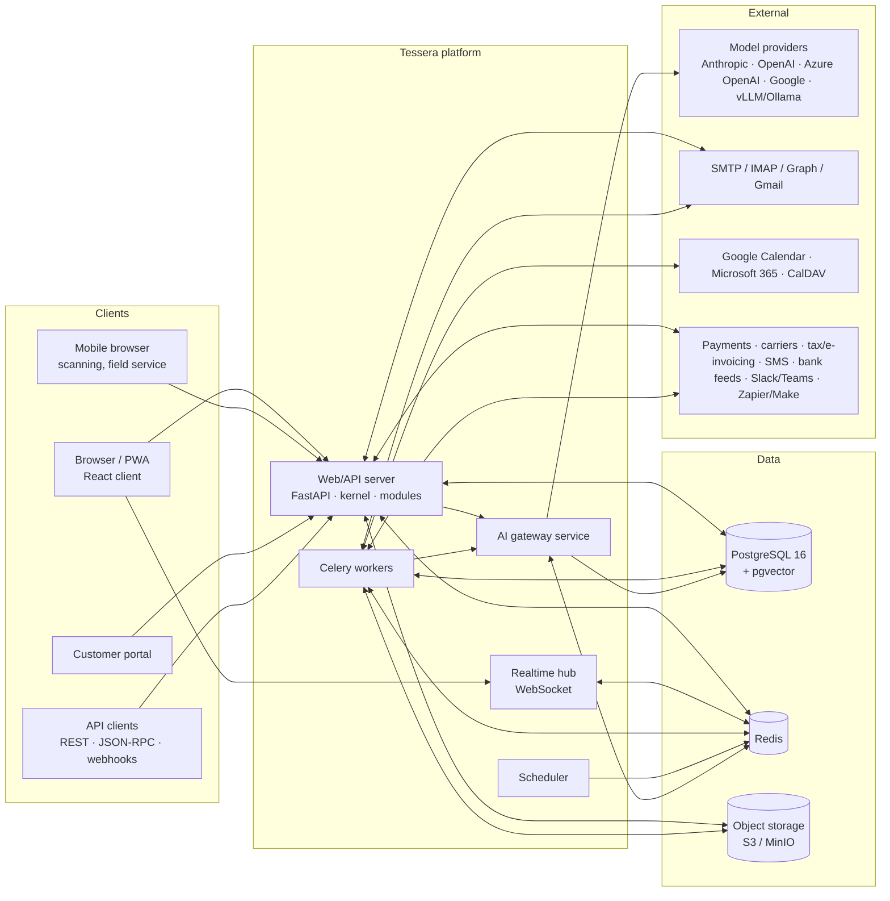

# Tessera — Architecture Document

**Status:** Draft for approval (pre–Phase 1)
**Audience:** engineers building the platform and its modules
**Companion documents:** [Module dependency map](MODULE_DEPENDENCY_MAP.md) · [Core ERD](ERD_CORE.md) · [AI architecture note](AI_ARCHITECTURE.md) · [Phased build plan](BUILD_PLAN.md) · [DECISIONS.md](../../DECISIONS.md)

---

## 1. What we are building

**Tessera** is an open, modular, multi-company business suite. A CRM sits at the core; every other business app (sales, accounting, e-signature, supply chain, manufacturing, operations, HR, marketing, website/eCommerce/POS, knowledge and administration) is a module installed on the same platform. AI is a platform layer, not a bolt-on: every module ships AI features that run through one gateway, under the requesting user's permissions, and never commit a change without a human.

The name comes from *tessera* — a single tile in a mosaic. Each module is a tile; the suite is the picture. (Working name, trivially renameable: see DECISIONS.md D-001.)

### 1.1 Design principles

1. **Metadata first.** Models, fields, views, menus, actions, security and workflows are *data* loaded from modules, inspectable at runtime, and extensible without forking. This is what makes no-code customisation (Studio), auto-generated APIs and AI tool-calling possible.
2. **One permission model, everywhere.** The ORM enforces access rights and record rules. The REST API, JSON-RPC, imports, reports, background jobs and AI tools all go through the ORM and inherit the same checks. There is no privileged side door.
3. **Modules are the unit of everything.** Code, schema, data, views, security, translations, tests, AI prompts, tools and evaluation sets live in the module that owns them. A module can be installed, upgraded and uninstalled.
4. **AI proposes, humans commit.** Any write, outbound message, payment, stock or accounting effect initiated by AI is a *proposal* until a user confirms it.
5. **Multi-company, multi-currency, multi-language, multi-timezone are kernel concerns**, not afterthoughts. Every business record carries `company_id`; every monetary field has a currency; every user has a language and timezone.
6. **Runnable at every phase.** Each phase ends with a Docker Compose stack, seed data, tests and a demo script.
7. **Original work.** Concepts shared with other business suites (chatter, kanban, record rules, many-to-one fields) are industry vocabulary; the design, naming, code and branding here are our own.

### 1.2 Stack

| Layer | Choice | Notes |
|---|---|---|
| Language | Python 3.12 | backend, kernel, workers, AI gateway, CLI |
| Web framework | FastAPI (ASGI, uvicorn) | async request handling, OpenAPI generation, Pydantic v2 schemas |
| Data access | Custom metadata ORM ("the kernel") on SQLAlchemy Core + psycopg 3 | see §4.3 and D-002 |
| Database | PostgreSQL 16 + `pgvector` | single database, multi-company; database-per-tenant optional |
| Cache / broker / pub-sub | Redis 7 | sessions, Celery broker, rate limits, realtime fan-out, AI response cache |
| Background work | Celery workers + DB-backed job ledger + scheduler process | §4.11 |
| Frontend | React 18 + TypeScript + Vite | metadata-driven view renderer, PWA |
| UI primitives | Radix UI + Tailwind CSS | accessible by construction (WCAG 2.1 AA target) |
| Data fetching | TanStack Query + typed client generated from OpenAPI | |
| Realtime | WebSocket (FastAPI) + Redis pub/sub | chatter, discuss, notifications, job progress, AI streaming |
| PDF | WeasyPrint (HTML/CSS templates via Jinja2) + `segno` (QR) | §4.14 |
| Object storage | S3-compatible (MinIO in dev) with local-FS fallback | attachments, sealed PDFs, exports |
| Email | SMTP out / IMAP in; Microsoft Graph and Gmail adapters | Mailpit in dev |
| Dev / deploy | Docker Compose; container images; GitHub Actions CI | |
| Observability | OpenTelemetry (traces, metrics), structlog JSON logs, Prometheus endpoint, Sentry-compatible error reporting | |

---

## 2. System context



**Request path.** A browser request hits the FastAPI server, is authenticated (session cookie + CSRF, or API key / bearer token), and resolved to an `Environment` (user, allowed companies, language, timezone, context). Controllers call ORM methods; the ORM compiles domains to SQL, applies record rules, checks field access, writes audit/tracking rows and publishes realtime events. Heavy work is enqueued as jobs. AI requests go to the **AI runtime** (in-process: prompts, tools, retrieval, proposals) which calls the **AI gateway** (separate service: provider adapters, routing, budgets, redaction, audit).

---

## 3. Repository layout (monorepo)

```
.
├── backend/
│   ├── tessera/                  # the kernel (Python package)
│   │   ├── orm/                  # fields, models, registry, environment, domain compiler, schema sync
│   │   ├── modules/              # manifest loading, dependency graph, install/upgrade/uninstall
│   │   ├── security/             # auth, sessions, groups, ACL, record rules, field access, API keys, 2FA, SSO
│   │   ├── api/                  # auto REST, JSON-RPC, OpenAPI, webhooks, pagination/filtering
│   │   ├── views/                # view schema, inheritance ops, validation
│   │   ├── jobs/                 # Celery app, job ledger, scheduler, retry policies, email queue
│   │   ├── realtime/             # websocket hub, Redis bus
│   │   ├── reports/              # PDF engine, template store, QR
│   │   ├── i18n/                 # translations, formatting helpers
│   │   ├── ai/                   # AI runtime: prompt registry, tools, retrieval, proposals, evals, flags
│   │   ├── cli/                  # `tessera` command
│   │   └── testing/              # fixtures, factories, module test runner
│   ├── modules/                  # business and platform modules, one directory each
│   │   ├── core/                 # company, user, group, currency, country, language, sequence, attachment, audit…
│   │   ├── chatter/              # messages, followers, tracking, activities, notifications
│   │   ├── web/                  # menus, actions, client assets registry, global search, favourites
│   │   ├── workflow/             # state machines, automated actions
│   │   ├── studio/               # no-code customisation
│   │   ├── ai_core/              # AI platform data: providers config, prompts, flags, audit, evals, embeddings
│   │   ├── contacts/ discuss/ calendar/ crm/ product/ sale/ portal/ …
│   │   └── <module>/
│   │       ├── manifest.toml
│   │       ├── models/           # Python model definitions and extensions
│   │       ├── controllers/      # optional custom endpoints
│   │       ├── views/*.json      # form/list/kanban/… definitions
│   │       ├── menus.json  actions.json
│   │       ├── security/         # groups.json, access.json, rules.json
│   │       ├── data/             # seed data (json), demo/ (demo data)
│   │       ├── reports/          # PDF templates
│   │       ├── i18n/*.po
│   │       ├── migrations/<version>/pre.py post.py down.py
│   │       ├── ai/               # prompts/*.yaml, tools.py, features.yaml, evals/*.jsonl
│   │       ├── static/           # optional client extensions
│   │       └── tests/
│   └── pyproject.toml
├── gateway/                      # AI gateway service (FastAPI): provider adapters, routing, budgets, cache, redaction
├── frontend/                     # React + TypeScript client (Vite), PWA
│   ├── src/kernel/               # action router, view renderer, field widgets, domain editor, command palette
│   ├── src/modules/<module>/     # optional module-specific widgets and client actions
│   └── e2e/                      # Playwright
├── deploy/
│   ├── compose/                  # docker-compose.yml (+ overrides), env examples
│   └── images/                   # Dockerfiles
├── docs/                         # architecture, admin guide, developer guide, AI governance, legal notes
├── .github/workflows/            # CI
├── DECISIONS.md  CHANGELOG.md  README.md
```

The frontend is a *generic client*: it renders whatever models, views, menus and actions the server exposes. Modules rarely ship frontend code; when they do (e.g. the Sign field editor, POS terminal, barcode scanner), it is registered through a client-extension registry and lazy-loaded.

---

## 4. The kernel

### 4.1 Module system

A module is a directory with a `manifest.toml`:

```toml
name = "crm"
version = "1.0.0"
summary = "Leads, opportunities, pipelines and sales teams"
category = "Sales"
phase = 1
depends = ["contacts", "chatter", "calendar", "product", "ai_core"]
license = "Apache-2.0"
installable = true
auto_install = false

[load]
security = ["security/groups.json", "security/access.json", "security/rules.json"]
data = ["data/stages.json", "data/lost_reasons.json", "data/sequences.json"]
views = ["views/lead.json", "views/team.json", "views/search.json"]
menus = "menus.json"
actions = "actions.json"
reports = ["reports/pipeline_summary.json"]
demo = ["data/demo/leads.json"]
ai = "ai/features.yaml"
```

**Lifecycle**

| Operation | Steps |
|---|---|
| Install | Resolve dependency closure (topological order) → import model code → compose model registry → **schema sync** → load security, data, views, menus, actions, AI assets (records are tagged with their owning module via `core.module_record`) → run `post_init` hook → mark installed with version. |
| Upgrade | Compare installed vs manifest version → run `migrations/<v>/pre.py` → re-import code and recompose registry → schema sync → reload data files honoring `noupdate` → run `post.py` → bump version. Every step is logged in `core.module_migration_log`. |
| Uninstall | Refuse if other installed modules depend on it → delete records owned by the module (reverse load order) → drop fields/tables introduced by the module (guarded by `--drop-data`; default keeps columns renamed `_removed_*` for 30 days) → recompose registry. |

A **registry** is built per database. All installed modules' model definitions are composed into final classes at startup (and on install/upgrade) and cached in-process; a `registry_version` key in Redis invalidates other workers.

### 4.2 Metadata ORM — models and fields

Models are declared in Python but are *metadata*: their definition is stored in `core.model` and `core.model_field` after composition so the client, Studio, the API generator and AI tools can introspect them.

```python
from tessera.orm import Model, fields

class Partner(Model):
    _name = "contacts.partner"
    _description = "Contact"
    _order = "display_name"
    _rec_name = "display_name"
    _inherit_mixins = ["chatter.thread", "chatter.activity_mixin", "core.multi_company"]

    name = fields.Char(required=True, index=True, translate=False, tracking=True)
    is_company = fields.Boolean(default=False)
    parent_id = fields.Many2one("contacts.partner", ondelete="restrict", index=True)
    child_ids = fields.One2many("contacts.partner", "parent_id")
    tag_ids = fields.Many2many("contacts.tag")
    email = fields.Char(index=True)
    display_name = fields.Char(compute="_compute_display_name", store=True, depends=["name", "parent_id.name"])
    credit_limit = fields.Monetary(currency_field="currency_id")
    currency_id = fields.Many2one("core.currency", default=lambda self: self.env.company.currency_id)
    country_code = fields.Related("country_id.code")
    notes = fields.Html(sanitize=True)
```

Another module extends the model without forking it:

```python
class PartnerCrm(Model):
    _extend = "contacts.partner"

    opportunity_ids = fields.One2many("crm.lead", "partner_id")
    opportunity_count = fields.Integer(compute="_compute_opportunity_count")

    def _compute_opportunity_count(self):
        counts = self.env["crm.lead"].read_group([("partner_id", "in", self.ids)], ["partner_id"], ["partner_id"])
        ...
```

Extension composes a new class with an MRO of all contributing fragments; `super()` chains work across modules. Methods can be overridden; fields can be added or have attributes modified (`fields.Char(string=..., required=True)` on an existing name merges attributes).

**Field types** (all required by the spec): `Char`, `Text`, `Html`, `Integer`, `Float(digits=)`, `Monetary(currency_field=)`, `Boolean`, `Date`, `Datetime`, `Selection`, `Many2one`, `One2many`, `Many2many`, `Binary` (stored in object storage; column holds a reference), `Json`, `Image` (Binary with resize variants). Every field accepts: `compute=` (+ `depends=`, `store=`, `inverse=`, `search=`), `related=`, `required`, `readonly`, `index` (btree / trigram / unique), `default`, `translate` (JSONB per-language storage, see §4.9), `company_dependent` (per-company value store), `tracking` (chatter change log), `groups` (field-level visibility), `help`, `copy`, `ondelete`, `domain`, `context`.

**Computed fields.** A dependency graph is built at registry composition. Writes mark dependents dirty; stored computes are recomputed before commit (batched per model); non-stored computes are evaluated lazily per transaction cache. Cross-record dependencies (`partner_id.name`) are resolved through inverse-field lookups.

**Recordset API** (illustrative):

```python
leads = env["crm.lead"].search({"all": [["stage_id.is_won", "=", False], ["team_id", "in", team_ids]]},
                               order="priority desc, expected_revenue desc", limit=80)
leads.write({"user_id": uid})                       # ACL + rules + tracking + audit + recompute
grouped = env["crm.lead"].read_group(domain, ["expected_revenue:sum"], groupby=["stage_id", "create_date:month"])
lead = env["crm.lead"].create({...}); lead.action_set_won()
```

`Environment` = (`cursor`, `user`, `company`, `companies`, `context{lang, tz, active_test, ...}`). Elevation is explicit, rare, and audited: `env.elevated(reason="sequence allocation")` is allowed only inside kernel/platform code, never in controllers or AI tools.

### 4.3 Domain DSL and SQL compilation

Domains are JSON, readable by humans and by the client's filter editor:

```json
{"all": [
  ["company_id", "in", "$companies"],
  {"any": [["user_id", "=", "$uid"], ["team_id.member_ids", "any", [["user_id", "=", "$uid"]]]]},
  {"not": ["stage_id.is_lost", "=", true]}
]}
```

Leaf: `[path, operator, value]`. Operators: `= != > >= < <= in not_in like ilike not_like not_ilike starts_with any not_any is_set is_not_set child_of parent_of`. Paths traverse relations (`partner_id.country_id.code`). Variables `$uid`, `$company`, `$companies`, `$now`, `$today`, `$user.<field>` are resolved at evaluation time (used by record rules and saved filters).

The compiler emits SQLAlchemy Core expressions: joins for many2one paths, `EXISTS` sub-selects for x2many paths, recursive CTEs for `child_of`/`parent_of`. The same domain can be evaluated in Python against in-memory records (used by record-rule checks on `write`/`unlink` and by automated-action filters).

### 4.4 Schema synchronisation and migrations

- **Declarative sync.** After registry composition, the kernel diffs field metadata against `information_schema` and applies *additive and safe* changes automatically: create tables, add nullable columns, add indexes (concurrently when possible), add FKs, add m2m join tables. Column type widening (int→bigint, varchar→text) is automatic; destructive changes are never automatic.
- **Versioned scripts.** `migrations/<version>/pre.py`, `post.py`, `down.py` handle data migrations and destructive changes explicitly. `down.py` is required for anything that drops or renames (reversibility is a non-functional requirement).
- **Studio changes** (runtime fields) use the same sync path inside a transaction and are recorded as `studio.change` rows with before/after metadata for rollback.
- `tessera db migrate` applies pending module upgrades; `tessera db check` reports drift without changing anything (used in CI).

### 4.5 Security

| Mechanism | Scope | Enforced where |
|---|---|---|
| Authentication | session cookie (HttpOnly, Secure, SameSite=Lax) + CSRF token for the web; API keys (hashed, scoped, expiring); OAuth2/OIDC and SAML SSO; TOTP 2FA; password policy + Argon2id | `tessera.security.auth` |
| Groups | hierarchical (`implied_groups`), per module (`crm.group_user`, `crm.group_manager`) | user ↔ group m2m |
| Access rights | per model × group: create/read/write/delete | ORM `check_access_rights` |
| Record rules | domain per model, global (AND) and per-group (OR), per operation | ORM search (domain injection) + write/unlink (re-check after fetch) |
| Field access | `groups=` on fields: hidden from read/write/export/API/AI unless user is in group | ORM `read`/`write` field filtering; views hide them |
| Multi-company | global rule `company_id in $companies` on every multi-company model; `company_dependent` fields | ORM |
| Portal | `portal.group_portal` users get narrow rules (`partner_id = $user.partner_id`) | same mechanism |
| PII access logging | fields flagged `pii=True` log reads in `core.pii_access_log` (sampled per request, not per row) | ORM read |
| Rate limiting | per IP, per user, per API key; stricter on auth endpoints and signer links | middleware + Redis |
| Audit | `core.audit_log` with who/what/when/before/after on create/write/unlink for tracked models | ORM |

Everything that reads or writes data — controllers, imports, reports, scheduled jobs acting *for* a user, AI tools — uses an `Environment` for a specific user. Background jobs that must run system-wide use the `system` user with explicit per-model rules and are logged as such.

### 4.6 Multi-company, currency, language, timezone

- **Company.** `core.company` (hierarchical). Users have `company_ids` (allowed) and `company_id` (current). The client exposes a company switcher that can select several companies at once; `$companies` drives record rules. Company-specific configuration lives in `core.company_setting` (key/value with typed metadata) or `company_dependent` fields.
- **Currency.** `core.currency` (ISO code, symbol, decimal places, rounding) and `core.currency_rate` (dated rates, per company). `Monetary` fields render with their currency and round with it. Conversion helper `currency.convert(amount, to_currency, company, date)` uses the rate valid on `date`. Rate providers (ECB, etc.) are scheduled jobs in `core`.
- **Language.** `core.language` with active flag, date/number formats, direction. Users carry `lang`. Translatable fields are stored as JSONB `{"en_US": "...", "fr_FR": "..."}` with fallback chain (user lang → company lang → `en_US`). UI strings: backend `.po` files per module, frontend JSON catalogs built from the same source. Translation export/import via CSV/PO.
- **Timezone.** Datetimes stored in UTC (`timestamptz`), `Date` fields are calendar dates. Users carry `tz`; the client formats with `Intl`; server-side renders (emails, PDFs) use the recipient's or company's timezone explicitly.

### 4.7 Chatter (`chatter` module)

Every business model mixes in `chatter.thread`:

- `chatter.message` (polymorphic on `model`, `res_id`): type `comment | note | notification | email | activity_done | system`, body (sanitised HTML), author, recipients, attachments, parent (threads), reactions, `tracking_value_ids`.
- `chatter.follower` (model, res_id, partner, subscribed subtypes).
- `chatter.tracking_value` — field change history captured automatically for `tracking=True` fields on write.
- `chatter.activity` — scheduled activities (`activity_type`: call, meeting, email, to-do, upload…), assignee, due date, summary, state (overdue/today/planned), feedback on done; feeds the per-user activity dashboard and AI daily ranking.
- Attachments: `core.attachment` (polymorphic, object storage key, checksum, mimetype, access token for portal/email links).
- Email bridge: outbound notifications render through templates and enter the mail queue; inbound mail to aliases (`crm@`, `helpdesk@`, `<thread-id>@`) routes to `message_new` / `message_update` on the owning model.

### 4.8 Sequences and numbering

`core.sequence`: code, company, prefix/suffix patterns (`INV/%(year)s/`), padding, step, `implementation = "gapless" | "standard"`. Gapless sequences use `SELECT … FOR UPDATE` on the sequence row; standard uses a Postgres sequence per (code, company) for throughput. Journals in accounting hold their own sequence per fiscal year (`INV/2026/00001`).

### 4.9 Workflows and automated actions (`workflow` module)

- **State machines as data.** `workflow.definition` (model, state field), `workflow.state`, `workflow.transition` (from, to, label, groups allowed, guard domain, guard method, side-effect methods, confirmation required). The kernel exposes `record.transition("confirm")`; the client renders transitions as status-bar buttons. Modules may still implement transitions in code; the definition then documents and guards them.
- **Automated actions.** `workflow.automation`: trigger (`on_create`, `on_write` with watched fields, `on_delete`, `on_time` relative to a date field, `on_transition`, `on_webhook`), filter domain (before/after), actions (set field values, create record, send email/SMS, add followers, schedule activity, call webhook, run server action (sandboxed expression language, not arbitrary Python), run AI feature → proposal). Studio edits these without code.

### 4.10 Notifications

`core.notification`: recipient, type, title/body, link, read state, channel preferences (in-app, email digest, push). In-app delivery via WebSocket; email through the mail queue; push via Web Push (VAPID) when a user registers a subscription (push-ready in Phase 1, provider wiring later).

### 4.11 Background jobs

- **Celery** (Redis broker) executes tasks. Every task enqueue also writes a `core.job` ledger row (uuid, name, args reference, state, attempts, next retry, owner, company, error, result ref) so jobs are visible, retryable and auditable in the UI.
- **Retry policies** per task: exponential backoff with jitter, max attempts, dead-letter state, idempotency keys.
- **Scheduler** process reads `core.scheduled_job` (cron expression or interval, next run, lock, active) and enqueues due jobs; distributed lock in Redis so multiple schedulers are safe.
- **Email queue** (`core.mail_queue`) is a specialised job: states `outgoing | sent | bounced | failed`, provider message id, retry policy, per-company SMTP settings, bounce processing.

### 4.12 Audit, soft delete, archive, undo

- `core.audit_log`: user, model, res_id, operation, changed fields with before/after (JSONB), request id, IP, timestamp. Configurable per model (default on for business documents).
- **Archive**: `active` boolean on most models; `active_test` context controls default filtering.
- **Soft delete**: `deleted_at`/`deleted_by` on models with `_soft_delete = True`; a 30-day trash with restore; hard delete by scheduled purge. Models with legal constraints (posted journal entries, completed envelopes) refuse delete entirely.
- **Undo**: the client offers *Undo* for reversible operations within a short window (archive, bulk write, delete to trash, stage change) by replaying the inverse from the audit record. Not offered for operations with external effects (sent email, payment, posted entry).

### 4.13 Import and export

`core.import_job`: file (CSV/XLSX), target model, column→field mapping (auto-suggested by header name and type; saved mappings), options (create/update by external id or key field, date/number formats), **dry run** that validates every row and reports errors by row/column before anything is written, then batched execution in a background job with progress. Export: choose fields (including related paths), format CSV/XLSX, respecting field-level access; saved export templates.

### 4.14 Report engine

- Templates are HTML/CSS (Jinja2) stored in `reports.template` with versioning; rendered to PDF by WeasyPrint in a worker; QR codes via `segno`.
- Per-company layout: header/footer, logo, colours, paper format (`reports.layout`).
- A **visual template editor** (Phase 1 basic, Phase 8 full): block-based editing of sections, field placeholders, tables with line models, conditional blocks; produces the same template format.
- Standard reports shipped with their modules (quote, invoice, PO, delivery slip, payslip, Certificate of Completion).

### 4.15 Global search, recents, favourites

`web.search_index` keeps a trigram-indexed summary per record for models that opt in (`_global_search = ["name", "email", "ref"]`); the command palette (`Ctrl/⌘-K`) searches records, menus and actions, and (Phase 8) hosts the global AI assistant. Recent items and favourites are per user.

### 4.16 API

- **REST** generated from metadata: `GET/POST /api/v1/<model>`, `GET/PATCH/DELETE /api/v1/<model>/{id}`, `POST /api/v1/<model>/{id}/call/<method>` (whitelisted methods). Query params: `domain` (JSON), `fields`, `order`, `limit`, `offset`/cursor, `expand` for nested reads. Responses carry `display_name` for relations and ETags for optimistic concurrency.
- **JSON-RPC** at `/jsonrpc` mirroring the ORM (`search_read`, `create`, `write`, `unlink`, `read_group`, `call`).
- **OpenAPI** document generated per database (reflecting installed modules and the caller's visible fields).
- **Webhooks** (`core.webhook`): model, events (create/write/delete, workflow transitions), filter domain, URL, secret (HMAC signature), retry policy, delivery log.
- **Auth**: API keys (`Authorization: Bearer tsk_…`), OIDC bearer tokens, or session. Permissions identical to the UI.

### 4.17 Developer CLI

`tessera` (Typer):

```
tessera db init|migrate|check|reset
tessera module scaffold <name> | install <name> | upgrade <name> | uninstall <name> | list
tessera seed demo [--modules crm,contacts]
tessera test [module…] [--coverage]
tessera serve | worker | scheduler | gateway
tessera user create|reset-password|grant
tessera ai eval run <feature> | eval report | prompt diff
tessera i18n export|import
```

---

## 5. Web client

### 5.1 Metadata-driven rendering

The client loads: session (user, companies, groups, lang, tz), menus (filtered by groups), and — on demand — actions and views. A **window action** names a model, the view types available, default domain/context and search view. The client fetches the view definitions (JSON) and the model's field metadata, then renders with generic components.

View definition (form, abbreviated):

```json
{
  "model": "crm.lead", "type": "form", "name": "crm.lead.form",
  "root": {"kind": "sheet", "children": [
    {"kind": "status_bar", "field": "stage_id", "transitions": ["action_set_won", "action_set_lost"]},
    {"kind": "group", "columns": 2, "children": [
      {"kind": "field", "name": "name", "widget": "title"},
      {"kind": "field", "name": "partner_id", "widget": "many2one", "options": {"create": true}},
      {"kind": "field", "name": "expected_revenue", "widget": "monetary"},
      {"kind": "field", "name": "probability", "widget": "progress", "readonly_if": [["stage_id.is_won", "=", true]]}
    ]},
    {"kind": "notebook", "pages": [{"title": "Notes", "children": [{"kind": "field", "name": "description", "widget": "html"}]}]}
  ]},
  "chatter": true
}
```

Supported view types: `form`, `list` (inline editing, grouping, aggregates, configurable columns), `kanban` (drag-drop across groups, progress bars, quick create), `calendar`, `pivot`, `graph`, `gantt`, `map`, `activity`, `search` (filters, group-bys, favourites). All view types are part of the kernel contract from Phase 1; `gantt` and `map` renderers ship when first consumed (Phase 4) — see D-010.

**View inheritance**: a module extends another module's view with operations against a JSON-pointer or `name` anchor: `{"op": "insert_after", "anchor": "partner_id", "node": {...}}`, `replace`, `remove`, `set_attr`. Studio produces the same operations, stored as `studio.view_change` with versions and rollback.

### 5.2 Cross-cutting UX

Responsive layouts with mobile-first variants for CRM kanban, activities, field service and barcode flows; PWA with offline shell and a sync queue for scanning. Keyboard shortcuts (global and per view), inline editing, bulk actions, saved filters, configurable columns, dark mode (CSS variables), drag-and-drop dashboards (Phase 8 `dashboards` module; Phase 1 ships a simple KPI home). Barcode/QR scanning via camera (`BarcodeDetector`/ZXing fallback) and USB keyboard-wedge scanners. Accessibility: semantic HTML, Radix primitives, focus management, contrast tokens, automated axe checks in Playwright.

### 5.3 Realtime

Clients subscribe to channels (`user:<id>`, `thread:<model>:<id>`, `channel:<id>`, `job:<uuid>`, `ai:<run_id>`). Server publishes to Redis; the WebSocket hub fans out. AI responses stream token deltas on `ai:<run_id>`. Presence is shared the same way: each process records its connections in a Redis sorted set (`tessera:presence:<db>`, scored by expiry, refreshed by a heartbeat), so any process can answer who is online.

---

## 6. AI layer (summary)

Detailed in [AI_ARCHITECTURE.md](AI_ARCHITECTURE.md). In one paragraph: the **AI gateway** is a separate service that owns provider adapters (Anthropic, OpenAI, Azure OpenAI, Google, vLLM/Ollama), task-based model routing with fallback, response caching, budgets and quotas, PII redaction, output schema validation, safety filtering, and the per-call usage/audit ledger. The **AI runtime** inside the application owns prompts (versioned registry, feature flags), tools (every tool executes ORM calls with the requesting user's `Environment`), retrieval (pgvector index over records/chatter/documents/knowledge, filtered by record rules *before* ranking), citations, **proposals** (every AI-initiated write/outbound action is a `ai_core.proposal` that a human accepts, edits or rejects), feedback, the evaluation harness and compliance metadata (EU AI Act classification, bias-testing requirements for employment features).

---

## 7. Tenancy and deployment

- **Default: single database, multi-company.** Record rules isolate companies; shared master data (currencies, countries) is global.
- **Database-per-tenant (option).** A tenant router resolves the host header to a database DSN; each database has its own registry, module set and AI configuration. Celery tasks carry the database name. The AI gateway keys budgets and provider configuration by `(database, company)`.
- **Processes**: `web` (N replicas, stateless), `realtime` (can be co-hosted with web), `worker` (queues: default, mail, reports, ai, imports), `scheduler` (1 active, lock-protected), `gateway` (N replicas). Dev: all in Docker Compose with Postgres, Redis, MinIO, Mailpit, optional Ollama.
- **Configuration**: environment variables + `tessera.toml`; secrets from env/secret manager, encrypted at rest in DB when stored (provider API keys, SMTP passwords, SSO client secrets) using envelope encryption with a master key.
- **Backups / PITR**: documented `pg_basebackup` + WAL archiving (WAL-G) recipe in Compose; object storage versioning for attachments; `tessera db check` as a health gate. Health endpoints `/healthz` (process) and `/readyz` (DB, Redis, storage, gateway).

---

## 8. Performance

- Lists: keyset pagination option, server-side `read_group` aggregates, indexes declared on fields (btree, GIN trigram for `ilike`, partial indexes for `active`), `EXPLAIN` tests on the 100k-record seed for the standard list views (target <300 ms p95).
- N+1 avoidance: batched prefetch of displayed fields and relations per recordset; `display_name` computed in bulk.
- Heavy work (imports, PDF, exports, embeddings, model training, reconciliation) always in workers with progress events.
- AI: streaming to UI; interactive suggestions budgeted at ≤3 s p95 (small models, cached context); anything slower is a job with a notification.
- Caching: registry and view definitions in-process + Redis invalidation; session and permission snapshots in Redis; AI response cache keyed by prompt version + redacted input hash.

---

## 9. Observability and reliability

Structured logs (structlog, JSON, request id, user id, company id, db), OpenTelemetry traces across web → worker → gateway → provider, Prometheus metrics (HTTP, ORM query timings, job latency/failures, mail queue depth, AI tokens/cost/latency per feature), Sentry-compatible error reporting. Graceful degradation: if the gateway or provider is unavailable, AI affordances show "unavailable" and manual workflows continue; circuit breakers per provider.

---

## 10. Testing strategy

| Level | Tooling | Where |
|---|---|---|
| Unit | pytest, hypothesis for ORM/domain compiler | `backend/tessera/**/tests`, `modules/*/tests` |
| Integration | pytest against Postgres (per-test transaction rollback), Redis, MinIO | module tests |
| API contract | schemathesis against generated OpenAPI; golden JSON snapshots | CI |
| Frontend unit | Vitest + Testing Library | `frontend/src` |
| End-to-end | Playwright, seeded demo scenarios per module, axe accessibility checks, visual regression for signer UI and POS | `frontend/e2e` |
| Security | tests for rule bypass, cross-company leaks, field-level access, CSRF, rate limits, signer-link reuse/forwarding, prompt-injection, AI tool permission | module + platform suites |
| AI evaluation | golden sets per feature, thresholds in `ai/features.yaml`, replay mode in CI (recorded provider responses), nightly live run | `tessera ai eval` |
| Performance | seeded 100k records, timing assertions on standard list/search endpoints | nightly |

Coverage target: 80% backend and frontend, enforced as a CI gate from Phase 1.

---

## 11. Security posture (OWASP ASVS L2 mapping, abbreviated)

Authentication (Argon2id, lockout, TOTP, SSO), session management (rotation, idle/absolute timeouts), access control (ORM-enforced, deny-by-default, tested for IDOR/cross-tenant), input validation (Pydantic, sanitised HTML via `nh3`, parameterised SQL only), output encoding (React, CSP with nonces), cryptography (envelope encryption of secrets, SHA-256 hashes, PAdES in Sign), error handling/logging (no PII or document content in logs), data protection (GDPR export/erase/consent records, PII access log), communications (TLS only, HSTS), file handling (type sniffing, size limits, AV hook), API (rate limits, key scoping, HMAC webhooks), AI-specific (prompt-injection tests, cross-tenant leak tests, tool-permission tests).

---

## 12. Explicit non-goals for Phase 1

Native mobile apps (PWA instead); database-per-tenant management UI (router only); SAML (OIDC first, SAML in Phase 2); full visual report editor (basic in Phase 1); Gantt/map renderers (Phase 4); marketplace distribution (Phase 8).
