# Tessera — Core Data Model (ERD)

**Status:** Draft for approval (pre–Phase 1)
**Scope:** the kernel/platform tables (`core`, `web`, `chatter`, `workflow`, `reports`, `studio`, `ai_core`) and the Phase 1 application tables (`contacts`, `crm`, `calendar`, `discuss`, `product`, `sale`, `portal`). Later phases (accounting, inventory, HR, Sign, …) get their own ERD at phase start; see §12.
**Companions:** [Architecture](ARCHITECTURE.md) · [Module dependency map](MODULE_DEPENDENCY_MAP.md) · [AI architecture note](AI_ARCHITECTURE.md) · [DECISIONS.md](../../DECISIONS.md)

---

## 1. Conventions

### 1.1 Naming
- Technical model name `module.model` (e.g. `crm.lead`); table name replaces the dot with an underscore (`crm_lead`) — D-006.
- Many-to-many join tables are named deterministically `<table>__<field>` (e.g. `core_user__company_ids`), with two FK columns and a composite primary key. Join tables are drawn in the diagrams only where the relation carries data of its own (`core_user_group`, `chatter_message_attachment`, `crm_team_member`, `discuss_channel_member`).
- Foreign-key columns end in `_id`; many-to-many fields end in `_ids`; the kernel exposes one-to-many fields (`child_ids`, `line_ids`) without any column of their own.

### 1.2 Common columns (omitted from every diagram)
Every model has:

| Column | Type | Notes |
|---|---|---|
| `id` | `bigint` identity PK | |
| `create_date`, `write_date` | `timestamptz` | set by the ORM |
| `create_uid`, `write_uid` | FK → `core_user` | set by the ORM |

Optional kernel conventions, present where stated in the column tables:

| Column | Meaning |
|---|---|
| `company_id` FK → `core_company` | multi-company model; the global record rule `company_id in $companies` applies |
| `active boolean default true` | archive (D-019) |
| `deleted_at timestamptz`, `deleted_by` FK → `core_user` | soft delete on `_soft_delete` models, 30-day trash (D-019) |
| `*_translated jsonb` | `translate=True` fields store `{"en_US": …, "fr_FR": …}` (D-009); the column keeps the field's name, the JSONB type is what marks it |
| `(model varchar, res_id bigint)` | polymorphic reference to any record, see §11.1 |

### 1.3 Types
`timestamptz` for all datetimes (UTC), `date` for calendar dates, `numeric(16,4)` for monetary amounts (rounded at display/posting with the currency's precision), `numeric` for floats where `digits=` is set, `text` for `Char`/`Text`/`Html` (the length limit is metadata, not a DB constraint), `jsonb` for `Json` and translatable fields, `vector(n)` from `pgvector` for embeddings. Binary data is never stored in a row: `core_attachment` holds an object-storage key.

### 1.4 Diagram notation
Mermaid `erDiagram`. `||--o{` = one-to-many, `}o--o{` = many-to-many, `||--||` = one-to-one, `o|` marks the optional side. Entity boxes list only the columns relevant to the diagram; the tables below each diagram list the non-obvious ones.

---

## 2. Identity and tenancy (`core`)

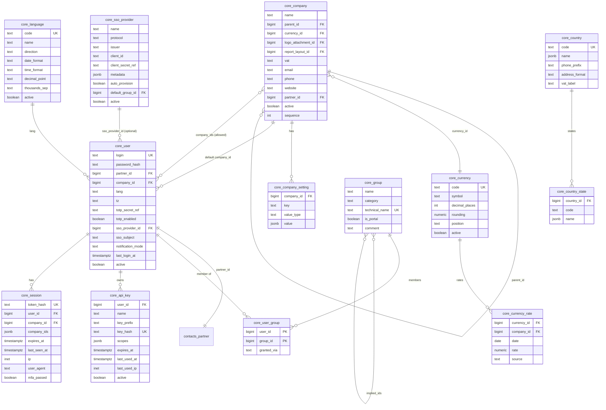

| Table.column | Notes |
|---|---|
| `core_company.parent_id` | company hierarchy; `child_of` domains use a recursive CTE. Consolidated reporting (Phase 2) walks this tree. |
| `core_company.partner_id` | the company's own contact record (address on documents, sender of emails). |
| `core_company.report_layout_id` | FK → `reports_layout`, per-company header/footer. |
| `core_user.partner_id` | one-to-one; every user is also a contact so chatter authorship, followers and portal access share one identity. Portal users have `is_portal` groups only. |
| `core_user.totp_secret_ref` | reference to an envelope-encrypted secret, never the secret itself. |
| `core_user.sso_subject` | stable subject identifier from the IdP; `UNIQUE (sso_provider_id, sso_subject)`. |
| `core_user_group.granted_via` | `direct` / `implied:<group_id>` — materialised closure of `implied_ids` so permission checks are a single index lookup. Recomputed when `implied_ids` changes. |
| `core_api_key.key_hash` | Argon2id hash of the secret; `key_prefix` (first 8 chars) is shown in the UI and indexed for lookup. `scopes` is a JSON array of `model:operation` grants intersected with the user's rights. |
| `core_session.company_ids` | the companies selected in the switcher for this session; drives `$companies` in record rules. |
| `core_currency_rate` | `UNIQUE (currency_id, company_id, date)`; `company_id NULL` = shared rate. `rate` is expressed as *units of this currency per one unit of the company currency*; conversion picks the latest row with `date <= :date`. |
| `core_company_setting` | `UNIQUE (company_id, key)`; typed via `value_type` (`bool`, `int`, `text`, `json`, `many2one:<model>`). |

---

## 3. Metadata registry (`core`, `web`)

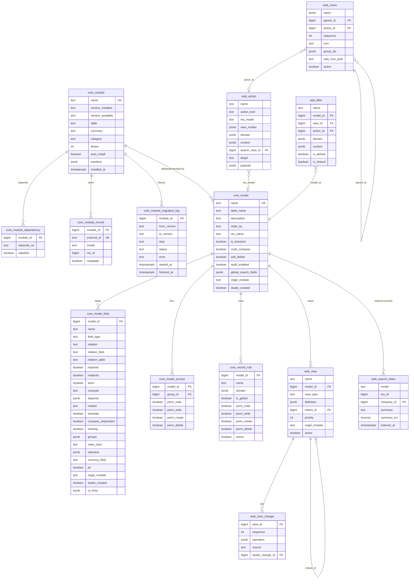

| Table.column | Notes |
|---|---|
| `core_module.state` | `uninstalled / to_install / installed / to_upgrade / to_remove`; `manifest` caches the parsed `manifest.toml`. |
| `core_module_record.external_id` | `module.identifier` (e.g. `crm.stage_qualified`); the stable handle data files, tests and Studio use to reference seeded records. `UNIQUE (model, res_id)` as well, so each record has one owner. |
| `core_model` / `core_model_field` | materialised from the composed registry after every install/upgrade/Studio change — the client, API generator, Studio and AI tool schemas read these rather than importing Python. `UNIQUE (model_id, name)`. |
| `core_model_field.index_kind` | `none / btree / unique / trigram / expression`; `groups` lists group technical names that may see the field; `pii` enables PII access logging. |
| `core_model_access` | `UNIQUE (model_id, group_id)`; `group_id` FK → `core_group` (not drawn); `group_id NULL` = applies to every authenticated user. |
| `core_record_rule` | `group_ids` m2m → `core_group` (not drawn). `is_global` rules are ANDed; per-group rules are ORed, then ANDed with the globals. The `domain` is the JSON DSL (D-005) and may use `$uid`, `$companies`, `$user.<field>`. |
| `web_view.definition` | the JSON view (see Architecture §5.1); the *effective* view = base `definition` with all active `web_view_change` operations applied in `sequence`, cached in Redis by `(view_id, registry_version)`. |
| `web_view_change.source` | `module` (from a module's view file) or `studio` (links to `studio_change` for rollback). |
| `web_action.action_kind` | `window / server / report / url / client`; `payload` carries kind-specific data (server-action steps, report template id, URL, client tag). |
| `web_filter` | saved filters and favourites; `user_id NULL` + `is_shared` = shared with everyone who can see the action. |
| `web_search_index` | one row per record of models that opt in via `_global_search`; GIN index on `summary_tsv` plus trigram on `summary` for the command palette. Rebuilt by a job when `global_search_fields` changes. |

### 3.1 Sequences, translations, attachments

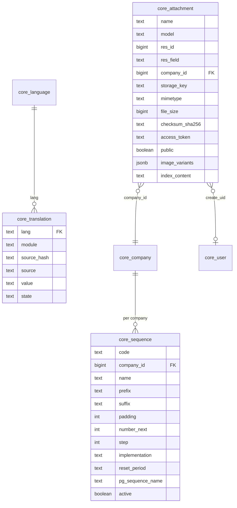

| Table.column | Notes |
|---|---|
| `core_sequence` | `UNIQUE (code, company_id)`; `implementation = gapless` locks the row (`SELECT … FOR UPDATE`) and bumps `number_next`; `standard` delegates to the Postgres sequence named in `pg_sequence_name`. `reset_period` (`never / year / month`) is how `INV/2026/00001` restarts each fiscal year. |
| `core_translation` | UI strings only (field translations live in their JSONB column). `UNIQUE (lang, module, source_hash)`. |
| `core_attachment` | `storage_key` is the S3/MinIO object key (or local path in dev); `checksum_sha256` deduplicates uploads; `access_token` is a random token for unauthenticated download links (portal, emails) and is rotated on demand. `res_field` is set when the attachment backs a `Binary`/`Image` field. Composite index on `(model, res_id)`. |

---

## 4. Chatter, activities, notifications, mail (`chatter`, `core`)

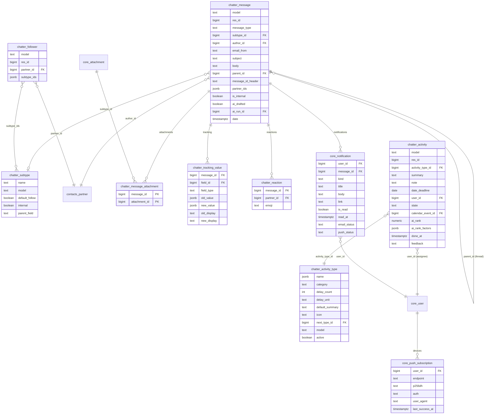

| Table.column | Notes |
|---|---|
| `chatter_message.message_type` | `comment / note / notification / email / activity_done / system`; `is_internal` hides notes from portal and email recipients. Composite index `(model, res_id, date desc)` serves every chatter load. |
| `chatter_message.message_id_header` | RFC 5322 `Message-ID` for threading inbound replies; unique partial index where not null. |
| `chatter_message.ai_drafted`, `ai_run_id` | AI-drafted content keeps the "AI-drafted" label until a human edits or explicitly reviews it; `ai_run_id` FK → `ai_core_run` for audit. |
| `chatter_tracking_value` | written on `write` for `tracking=True` fields; `field_id` FK → `core_model_field`. Values are JSONB so any field type (incl. many2one as `{"id":…, "display_name":…}`) is captured. |
| `chatter_follower` | `UNIQUE (model, res_id, partner_id)`; `subtype_ids` controls which message subtypes notify this follower. |
| `chatter_activity.state` | computed `overdue / today / planned / done` relative to the assignee's timezone; stored and refreshed nightly so it can be grouped and indexed. `ai_rank` and `ai_rank_factors` back the AI daily to-do ranking (explainable). |
| `chatter_activity.calendar_event_id` | meeting activities link to `calendar_event`. |
| `core_notification` | in-app inbox; `email_status` / `push_status` track delivery per channel per user's `notification_mode`. |

### 4.1 Mail servers, aliases, queue

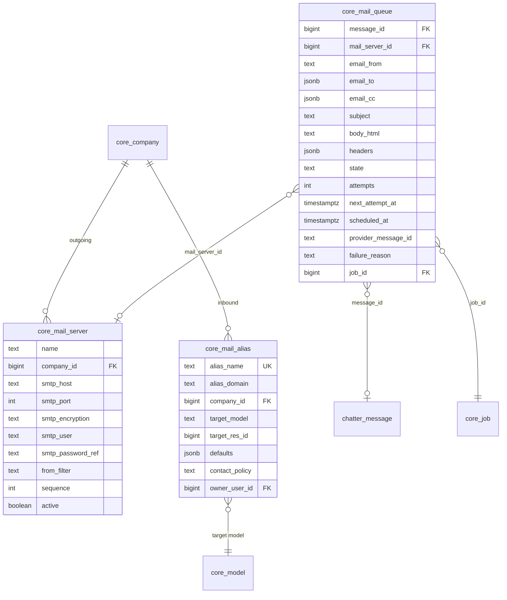

`core_mail_alias.target_res_id` is `NULL` for "create a new record" aliases (e.g. `crm@` → new `crm.lead`) and set for per-thread reply aliases (`<thread-token>@`), which call `message_update` on the existing record. `contact_policy` (`everyone / followers / partners`) gates who may write in. `core_mail_queue.state` is `outgoing / sent / bounced / failed / cancelled`; the row is the durable side of the Celery mail task (Architecture §4.11).

---

## 5. Workflow, automation, jobs, audit, import, reports, Studio

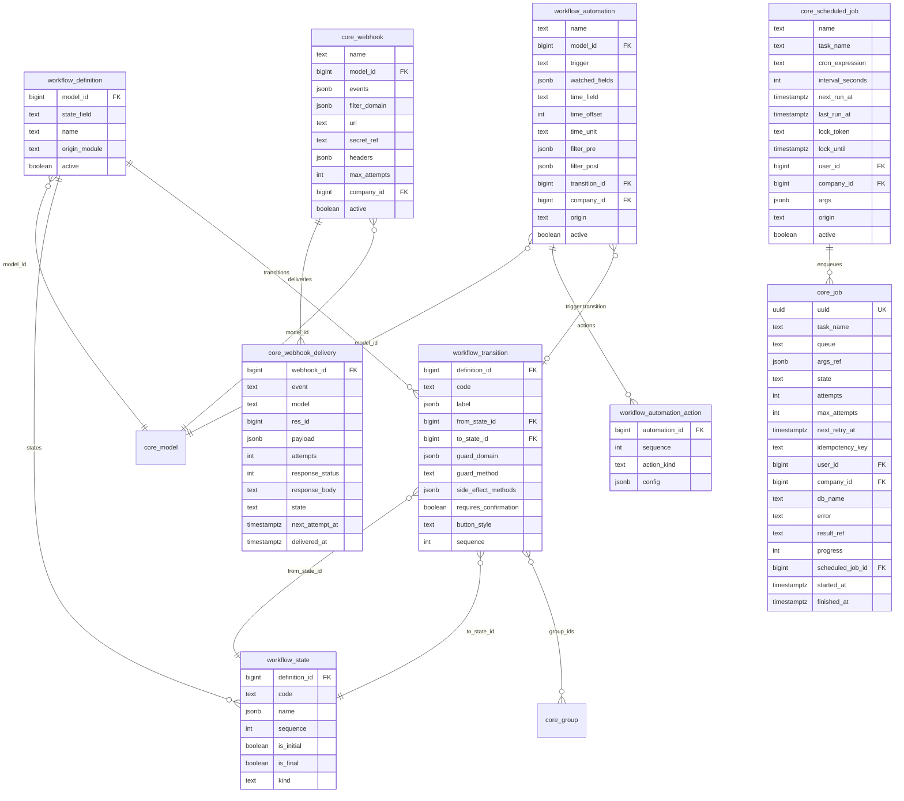

| Table.column | Notes |
|---|---|
| `workflow_state.kind` | `normal / won / lost / cancelled / done` hints for kanban progress bars and reports; `is_final` blocks further transitions unless a transition explicitly leaves the state. |
| `workflow_transition.guard_domain` / `guard_method` | both must pass; `side_effect_methods` lists whitelisted model methods called after the state write. `requires_confirmation` shows a dialog in the client and is mandatory for transitions AI proposals may trigger. |
| `workflow_automation.trigger` | `on_create / on_write / on_delete / on_time / on_transition / on_webhook`; `time_field` + `time_offset` + `time_unit` for `on_time` (e.g. 3 days after `date_deadline`). `origin` is `module / studio / ai_proposal`. |
| `workflow_automation_action.action_kind` | `set_values / create_record / send_email / send_sms / add_followers / schedule_activity / call_webhook / server_action / ai_feature`; `config` is validated against a per-kind JSON Schema. `ai_feature` always ends in a proposal, never a direct write. |
| `core_job` | the ledger mirror of every Celery task (D-008). `idempotency_key` has a unique partial index so duplicate enqueues collapse. `db_name` supports database-per-tenant routing. |
| `core_scheduled_job.lock_token` / `lock_until` | DB-side fencing in addition to the Redis lock, so a scheduler restart cannot double-fire. |
| `core_webhook.secret_ref` | encrypted HMAC secret; deliveries are signed `X-Tessera-Signature: sha256=…`. `core_webhook_delivery` is purged after 30 days by a scheduled job. |

### 5.1 Audit, PII log, import, reports, Studio

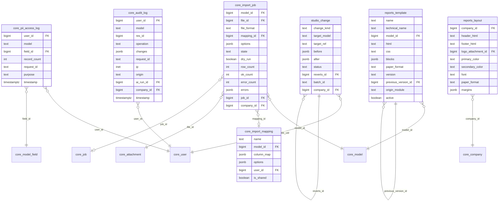

| Table.column | Notes |
|---|---|
| `core_audit_log.changes` | `{"field": {"old": …, "new": …}}` for `write`; full values for `create`/`unlink`. `origin` is `ui / api / import / job / ai_tool / automation`; `ai_run_id` links AI-accepted proposals to the run that produced them. Partitioned by month from Phase 2 when volumes justify it. |
| `core_pii_access_log` | one row per `(request, model, field)` with a `record_count`, not per row — Architecture §4.5. |
| `core_import_job.errors` | `[{"row": 12, "column": "email", "message": …}]` from the dry run; a dry run writes nothing but keeps this report. |
| `reports_template.blocks` | the visual editor's block tree; `html`/`css` is what the engine renders, regenerated from `blocks` when the editor is used, hand-edited otherwise. Editing creates a new version row and links `previous_version_id`. |
| `studio_change` | every Studio action (field added, view op, automation, menu) stores `before`/`after` metadata; rollback inserts a new row with `reverts_id` and replays `before`. `batch_id` groups the changes of one Studio session. |

---

## 6. Contacts

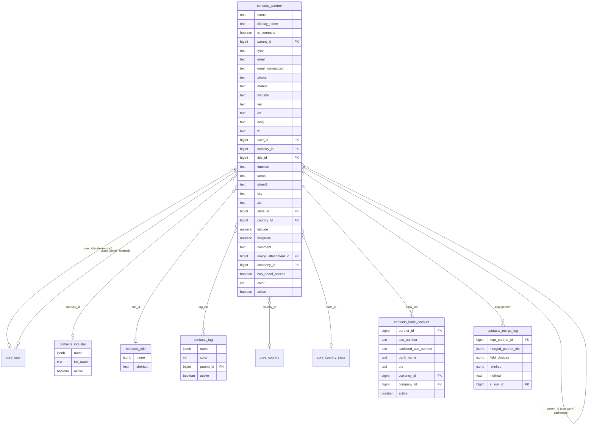

| Table.column | Notes |
|---|---|
| `contacts_partner.type` | `contact / invoice / delivery / other`; addresses are child partners of a company partner with `is_company = false`. `display_name` is a stored compute (`"Company, Person"`) with a trigram index — it is the column list views and `name_search` hit. |
| `contacts_partner.email_normalized` | lower-cased, trimmed, used for duplicate detection and inbound mail matching; btree index. |
| `contacts_partner.company_id` | nullable: `NULL` means shared across companies (the default for contacts); a company-specific contact is visible only to that company. |
| `contacts_partner.has_portal_access` | stored compute from `portal_access`; the portal rule for partners is `id = $user.partner_id or parent_id = $user.partner_id`. |
| `contacts_bank_account.sanitized_acc_number` | `UNIQUE (sanitized_acc_number, company_id)`; the accounting module (Phase 2) adds `journal_id`. |
| `contacts_merge_log` | the merge wizard's record: which partner survived, which were archived/removed, which field value was chosen per field, and every `(model, field)` re-pointed in `relinked`. `method` is `manual / rule / ai_suggested`; AI-suggested merges are proposals first. |

---

## 7. CRM

### 7.1 Leads, opportunities and their lookups

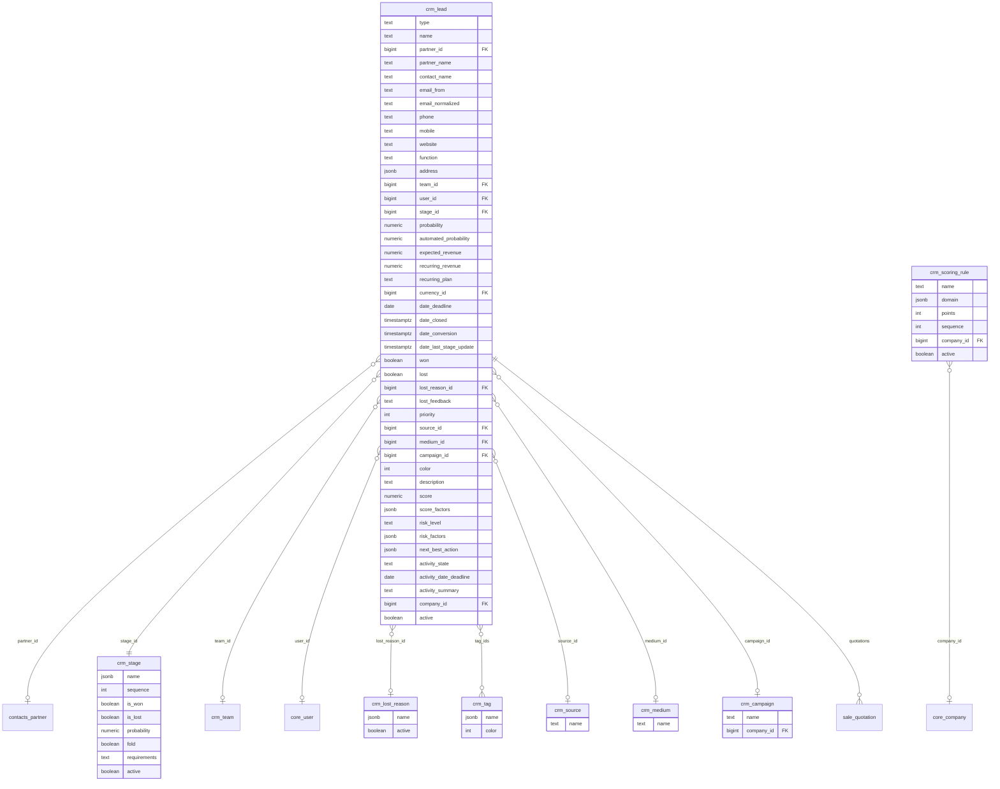

### 7.2 Teams, assignment, forecasts, intake

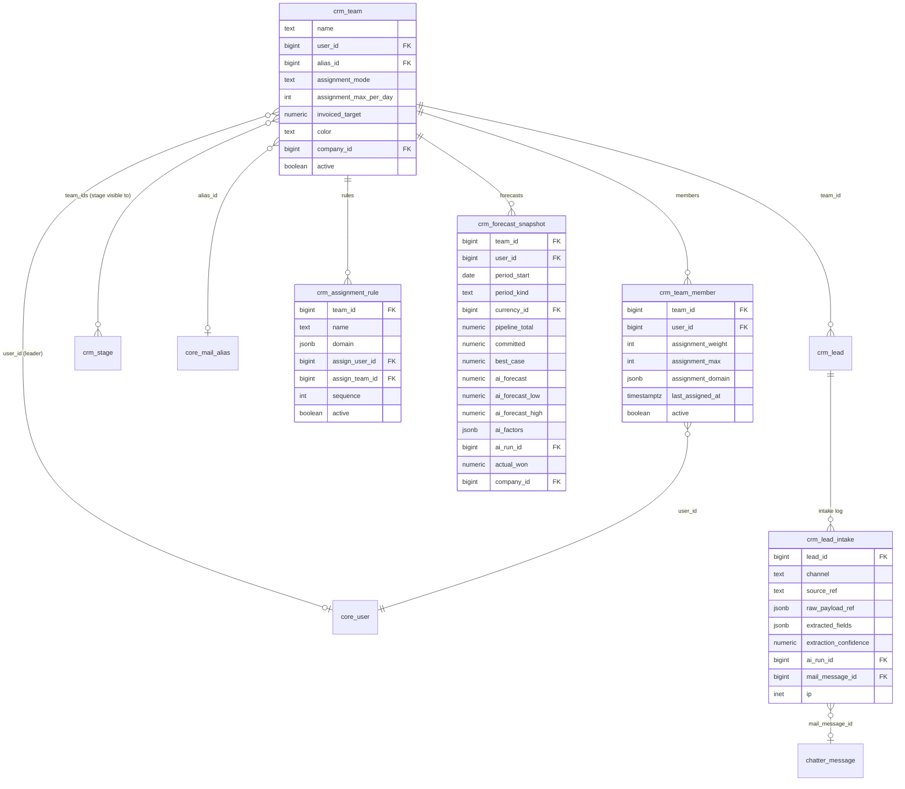

| Table.column | Notes |
|---|---|
| `crm_lead.type` | `lead / opportunity`; conversion sets `type = opportunity`, `date_conversion`, links/creates `partner_id`, keeps the captured contact fields for history. |
| `crm_lead.probability` vs `automated_probability` | `probability` is what the user sees and can override; `automated_probability` is the current predictive score. If the user has not overridden, `probability` follows the stage default (rule-based, Phase 1) or the model (predictive, Phase 1.6). |
| `crm_lead.score`, `score_factors` | rule-based points from `crm_scoring_rule` plus the predictive component; `score_factors` is `[{"factor": "Replied within 24h", "weight": +12}, …]` for the explainability requirement. |
| `crm_lead.risk_level`, `risk_factors`, `next_best_action` | AI outputs stored on the record (advisory, labelled); refreshed by the deal-risk job; no write to any other field without a proposal. |
| `crm_lead.activity_*` | denormalised from `chatter_activity` for list/kanban sorting ("my next activity"); refreshed on activity write. |
| `crm_lead.won` / `lost` | derived from the stage's `is_won`/`is_lost` at the time of the move and stored so historical reports survive stage edits. `lost` leads are archived (`active = false`) and keep `lost_reason_id`. |
| Indexes | `(team_id, stage_id)` for kanban columns, `(user_id, activity_date_deadline)` for the activity dashboard, trigram on `name` and `partner_name`, btree on `email_normalized` and `date_deadline`, partial on `active`. |
| `crm_team.assignment_mode` | `manual / round_robin / rules`; `crm_team_member.assignment_weight` and `assignment_max` drive round-robin, `assignment_domain` restricts which leads a member can receive; `crm_assignment_rule` routes by domain to a user or a team. AI lead routing (Phase 1.6) proposes an assignee; acceptance writes `user_id`. |
| `crm_stage` | stages are global by default; `team_ids` restricts a stage to given teams. `requirements` is free text shown in the kanban column tooltip. |
| `crm_forecast_snapshot` | one row per `(team or user, period)`; snapshots are frozen weekly so forecast accuracy can be measured against `actual_won` later. `period_kind` is `month / quarter`. |
| `crm_lead_intake.channel` | `manual / web_form / email / api / import`; `raw_payload_ref` points at an attachment (the form post or the raw email), `extracted_fields` and `extraction_confidence` record what AI extraction proposed. |

---

## 8. Calendar and Discuss

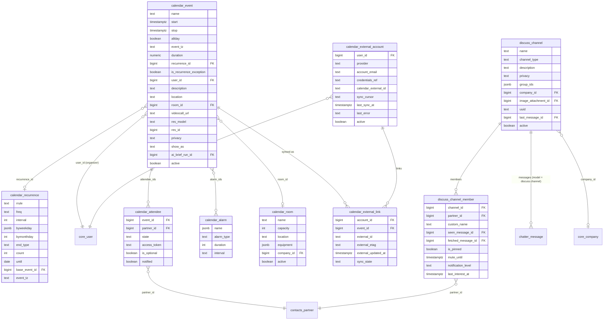

| Table.column | Notes |
|---|---|
| `calendar_event.start` / `stop` | always `timestamptz`; `allday` events store midnight in `event_tz` and are rendered as dates. Indexes on `(start, stop)` and on `(user_id, start)`; attendee lookups go through `calendar_attendee (partner_id, event_id)`. |
| `calendar_event.recurrence_id`, `is_recurrence_exception` | occurrences are materialised rows (one per occurrence within a rolling horizon, extended by a job) so they can be searched, synced and linked; an edited occurrence is flagged as an exception and detached from future bulk edits. |
| `calendar_event.res_model` / `res_id` | polymorphic link to the business record (opportunity, ticket, applicant) — the source of AI meeting briefs; `ai_brief_run_id` points at the last generated brief. |
| `calendar_attendee.state` | `needs_action / accepted / declined / tentative`; `access_token` lets external attendees respond from an email link. |
| `calendar_room` | room booking is a `room_id` on the event; the overlap constraint is enforced in the ORM (`EXCLUDE USING gist` on `(room_id, tstzrange(start, stop))` is added as a DB-level guard). |
| `calendar_external_account.provider` | `google / microsoft / caldav`; `credentials_ref` → envelope-encrypted OAuth tokens or CalDAV credentials; `sync_cursor` is the provider's incremental token. `calendar_external_link` has `UNIQUE (account_id, external_id)` and `sync_state` (`synced / pending_push / pending_pull / conflict`). |
| `discuss_channel.channel_type` | `channel / group / dm`; `privacy` is `public / groups / invite`. DMs have exactly two members and a deterministic `uuid`. Messages are `chatter_message` rows with `model = 'discuss.channel'`, so mentions, reactions, attachments and threads are the same code path as record chatter. |
| `discuss_channel_member.seen_message_id` / `fetched_message_id` | unread counters and read receipts; `UNIQUE (channel_id, partner_id)`. |

---

## 9. Product, quotations, portal (Phase 1 subset — D-011)

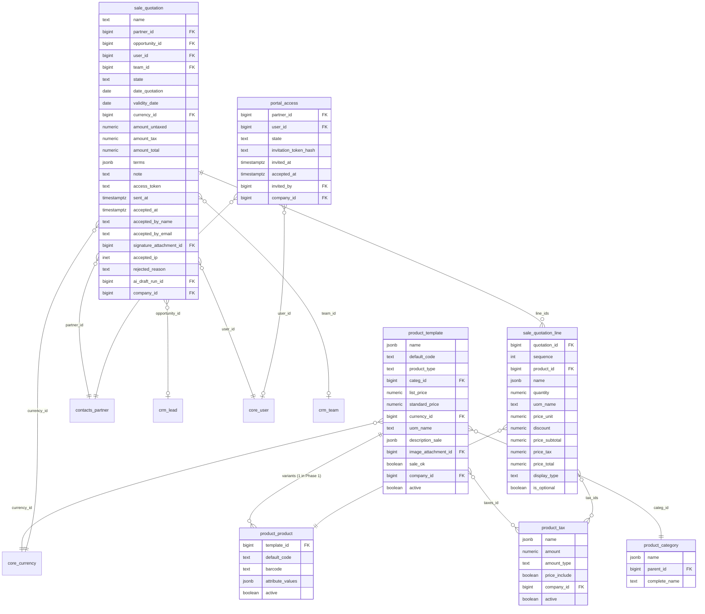

| Table.column | Notes |
|---|---|
| `product_template` / `product_product` | kept minimal for Phase 1 (no attributes/variants, `uom_name` is free text, `product_tax` is a stub). Phase 2 adds attribute lines, UoM, pricelists, and replaces `product_tax` with `account.tax`; the FKs are named so that migration is a rename, not a re-link. |
| `sale_quotation.name` | from sequence `sale.quotation` per company (`QT/2026/00001`). `state` is a `workflow_definition`: `draft → sent → accepted / rejected / expired`; expiry is an `on_time` automation on `validity_date`. |
| `sale_quotation.access_token` | random token for the portal link; the portal rule is `partner_id = $user.partner_id or partner_id.parent_id = $user.partner_id`, and token links are rate-limited. Acceptance captures name, email, IP, and an optional drawn signature as an attachment (the Phase 2b Sign module replaces this with an envelope). |
| `sale_quotation.ai_draft_run_id` | set when the quotation was drafted from an AI proposal (lines generated from an opportunity); the "AI-drafted" label clears on first human edit. |
| `sale_quotation_line.display_type` | `NULL / section / note` for layout lines; `is_optional` lines are shown as upsells in the portal and excluded from totals until accepted. |
| `portal_access.state` | `invited / active / revoked`; `invitation_token_hash` is single-use. Creating portal access creates a `core_user` with only `portal.group_portal`. |

---

## 10. AI platform (`ai_core`)

### 10.1 Configuration, routing, prompts, features

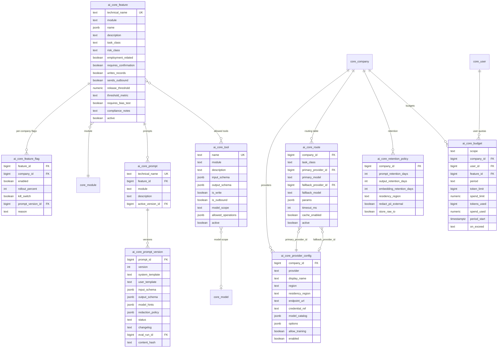

| Table.column | Notes |
|---|---|
| `ai_core_provider_config.provider` | `anthropic / openai / azure_openai / google / vllm / ollama / mock`; `region` is the provider endpoint region (e.g. Anthropic `inference_geo`, Azure resource region, Vertex location), `residency_region` is the company's declared residency requirement — the gateway refuses a route whose provider region is outside it. `credential_ref` → envelope-encrypted key; `allow_training` defaults to `false` and is informational (providers' no-training terms are configured on the provider side). |
| `ai_core_route` | `UNIQUE (company_id, task_class)`; `task_class` ∈ `classify / extract / embed / summarize / draft / reason / translate / vision / transcribe`. `params` holds effort/temperature equivalents per provider; the gateway enforces `timeout_ms` and falls back on timeout, 5xx or refusal. |
| `ai_core_feature.risk_class` | EU AI Act classification `minimal / limited / high`; `employment_related = true` forces `risk_class = high`, `requires_bias_test = true` and `requires_confirmation = true`. `release_threshold` + `threshold_metric` (e.g. `accuracy >= 0.85`) gate activation in CI and at runtime: a feature with no passing `ai_core_eval_run` for the active prompt version cannot be enabled. |
| `ai_core_feature_flag` | `UNIQUE (feature_id, company_id)`; `company_id NULL` is the platform default. `kill_switch = true` overrides everything, including rollout. `prompt_version_id` pins a company to a version during staged rollout. |
| `ai_core_prompt_version.status` | `draft / testing / active / retired`; only one `active` per prompt (partial unique index). `content_hash` is part of the response-cache key. `redaction_policy` lists which input fields are PII and whether the feature needs them. |
| `ai_core_tool` | the typed tool catalogue the model may call. `is_write` / `is_outbound` tools always produce proposals; `model_scope` + `allowed_operations` (`search / read / read_group / propose_write / propose_create / propose_message`) bound what the tool handler may do — the handler itself still runs through the user's `Environment`. |
| `ai_core_budget.scope` | `company / user / feature`; `period` ∈ `day / month`; `on_exceed` ∈ `block / degrade_to_small_model / notify`. Counters are incremented from the usage ledger by the gateway. |

### 10.2 Runs, tool calls, proposals, citations, feedback, evaluation, embeddings

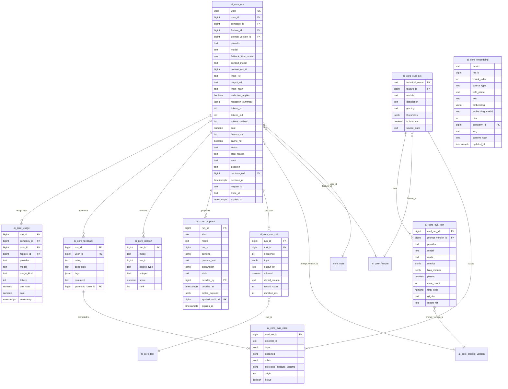

| Table.column | Notes |
|---|---|
| `ai_core_run` | the audit record required by the spec: who, which feature, which prompt version, which model (and `fallback_from_model` when the primary failed), input/output references (object-storage keys, subject to `ai_core_retention_policy` — `expires_at` is set from it and a purge job deletes the blobs while keeping the row), redaction evidence, tokens/cost/latency, and the human `decision` (`none / accepted / edited / rejected / expired`). `context_model`/`context_res_id` is the record the user was looking at. Indexes on `(company_id, feature_id, create_date)` and `(user_id, create_date)` feed the admin cost and quality dashboards. |
| `ai_core_tool_call.allowed` | `false` with `denial_reason` when the tool handler refused (ACL, record rule, field group, kill switch); denied calls are still logged — they are the evidence for the tool-permission tests. `record_count` is what the tool returned after record-rule filtering. |
| `ai_core_proposal.kind` | `create / write / message / action / transition`; `payload` is a diff (`{"field": {"old": …, "new": …}}`) or the outbound message; `preview_text` is what the UI shows; `explanation` carries the top factors. Accepting applies the payload (or `edited_payload`) through the user's `Environment` and records `applied_audit_id` → `core_audit_log` (which in turn carries `ai_run_id`). Pending proposals expire (`expires_at`) so stale suggestions never apply. |
| `ai_core_citation` | one row per source the answer used; the UI renders them as links. `source_type` ∈ `record / chatter / document / knowledge`. |
| `ai_core_feedback.rating` | `up / down`; a correction can be promoted to an `ai_core_eval_case` (`promoted_case_id`), closing the feedback → evaluation loop. |
| `ai_core_eval_set` / `_case` / `_run` | golden sets live in the module (`ai/evals/*.jsonl`, `source_path`) and are loaded into these tables for the harness; `grading` ∈ `exact / schema / rubric_llm / numeric_tolerance`; `is_bias_set` marks the sets with `protected_attribute_variants` required for employment-related features. `ai_core_eval_run.mode` is `replay / live` (D-017); `passed` is what the release gate reads. |
| `ai_core_embedding` | `UNIQUE (model, res_id, chunk_index, field_name, embedding_model)`; `vector` dimension is fixed per `embedding_model` (one HNSW index per dimension, see §11). `content_hash` skips re-embedding unchanged text. Rows are deleted with their source record (polymorphic cleanup, §11.1) and purged by `embedding_retention_days`. Retrieval joins on `(model, res_id)` against the caller's record-rule-filtered id set *before* ordering by distance. |
| `ai_core_usage.usage_kind` | `input / output / cached_input / embedding / audio_seconds / image`; the gateway writes these lines and aggregates them into `ai_core_budget` counters and the cost dashboard. |

---

## 11. Cross-cutting design notes

### 11.1 Polymorphic references
Chatter, followers, activities, attachments, audit log, notifications, search index, embeddings, calendar event links, CRM intake and AI runs all point at "any record" with the pair `(model varchar, res_id bigint)` rather than a hard FK. This keeps those tables module-agnostic and lets new modules get chatter, audit and AI for free.

- Every such table has a composite btree index `(model, res_id)` (plus `date desc` where a timeline is read).
- There is no database FK, so referential cleanup is the ORM's job: `unlink` (and hard-delete after the trash period) calls the registered polymorphic cleaners — messages, followers, activities, attachments, embeddings, search-index rows, notifications, proposals (marked `expired`) and external calendar links are removed or detached in the same transaction. `core_audit_log` and `ai_core_run` rows are kept (they are the evidence) with `res_id` left as-is.
- A nightly `core.polymorphic_integrity` scheduled job scans for orphans (a sampled anti-join per model) and reports counts; it never deletes silently.
- Model renames write a `core_module_migration_log` step that updates the `model` column across all polymorphic tables in one migration helper.

### 11.2 Indexing strategy for 100k-row lists
The performance target (list views < 300 ms at 100k records) is met with declared indexes, not query-time heroics:

| Pattern | Index |
|---|---|
| Every many2one column | btree (`index=True` is implied for FKs; the schema sync creates them) |
| `active` on archivable models | partial index `WHERE active` on the default sort column (`crm_lead (team_id, stage_id) WHERE active`) |
| `name`, `display_name`, `email`, `ref` searched with `ilike` | GIN `gin_trgm_ops` (pg_trgm) |
| Translatable JSONB fields that are sorted or searched | expression index per active language, `((name ->> 'en_US'))`, created lazily by the sync when a language is activated |
| Date range scans (`date_deadline`, `start/stop`, `create_date`) | btree, composite with the usual filter column (`(user_id, date_deadline)`) |
| Composite "kanban column" queries | `(team_id, stage_id)`, `(stage_id, user_id)` |
| Unique business keys | unique btree, often partial (`WHERE deleted_at IS NULL`) |
| Polymorphic tables | `(model, res_id[, date desc])` |
| Full-text / command palette | GIN on `tsvector` + trigram on summary |
| Embeddings | HNSW on `vector` with `vector_cosine_ops`, one index per `(embedding_model)` partition; `m = 16`, `ef_construction = 64`; queries set `hnsw.ef_search` per request |

`read_group` aggregates (`sum`, `count`, `avg`) run as SQL `GROUP BY` with the same indexes; list views request only displayed fields and the ORM prefetches related `display_name`s in one query per relation. Keyset pagination (`order + id` cursor) is available for infinite-scroll lists; offset pagination is kept for the API.

### 11.3 Row-level security
Row-level security is implemented by the ORM compiling record rules into every query (`WHERE … AND (<rule domain SQL>)`), not with PostgreSQL `ROW LEVEL SECURITY` policies. Reasons:

1. **Per-request company switching.** A user can select any subset of their allowed companies per request (`$companies`); expressing that with Postgres session settings per connection in a pooled, async server is fragile and defeats statement caching.
2. **Domain expressiveness.** Rules reference relation paths (`team_id.member_ids.user_id`), hierarchical operators (`child_of`), and user attributes (`$user.partner_id`); the domain compiler already produces the joins and CTEs these need, and the same domain is evaluated in Python on `write`/`unlink` re-checks.
3. **One enforcement point.** The API, imports, reports, automations and AI tools all go through the ORM, so there is no path that bypasses rules; Postgres RLS would add a second, divergent policy language to keep in sync.
4. **Testability.** Record-rule tests assert on compiled SQL and on result sets per user, including cross-company leak tests, without needing database roles per user.

The database roles are therefore few (`app`, `migrate`, `readonly_reporting`), and the `readonly_reporting` role is the only one that reads tables directly — for BI tooling with its own company filtering.

---

## 12. Deferred to later phases
Each of these gets its own ERD document at the start of its phase, extending the models above (e.g. `contacts_partner` gains receivable/payable accounts; `product_tax` is replaced by `account.tax`):

- **Phase 2:** `sale` (orders, templates, pricelists, variants, UoM), `sale_subscription`, `sale_rental`, `sale_commission`, `account` (chart of accounts, journals, moves, payments, bank statements, taxes, fiscal positions, analytic, budgets, assets, tax reports, e-invoicing), `payment`.
- **Phase 2b:** `sign` (templates, template versions, envelopes, roles, fields, signers, events hash chain, certificates, verification).
- **Phase 3:** `purchase`, `inventory` (warehouses, locations, moves, quants, lots, valuation), `inventory_barcode`, `shipping`, `manufacturing`, `quality`, `maintenance`, `fleet` (`uom` arrives in Phase 2 with `account`).
- **Phase 4:** `project`, `timesheet`, `helpdesk`, `field_service`, `planning`, `appointment`.
- **Phase 5:** `hr` and its satellites (`recruitment`, `time_off`, `attendance`, `expense`, `appraisal`, `payroll`) with role-restricted private data tables.
- **Phase 6–8:** marketing and engagement, website/eCommerce/POS, documents/knowledge/approvals/dashboards/spreadsheet/marketplace/IoT.
