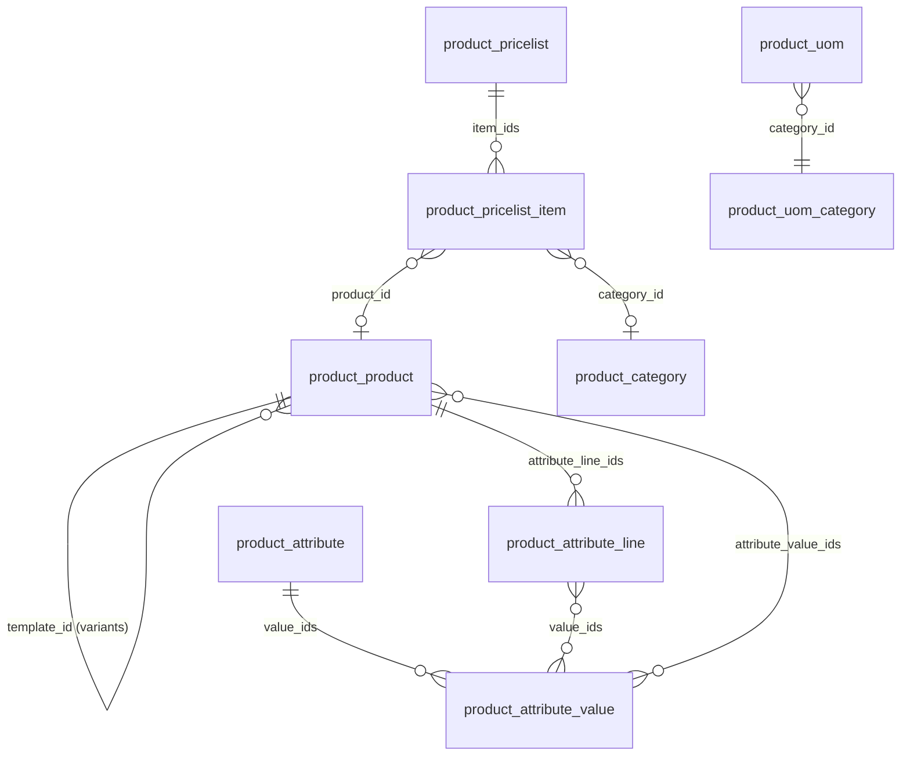
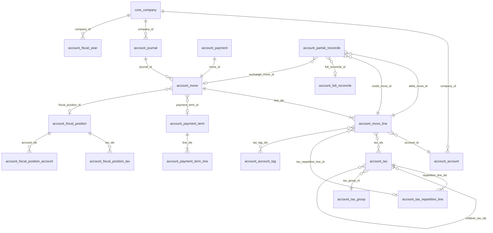

# Tessera — Phase 2 data model (Sales and Accounting)

**Status:** Accepted at Phase 2 start (2026-11-10). Extends [ERD_CORE.md](ERD_CORE.md); plan in
[BUILD_PLAN.md §3](BUILD_PLAN.md#3-phase-2--sales-and-accounting); decisions D-069 to D-075 in
[DECISIONS.md](../../DECISIONS.md).

Conventions are those of the core ERD: every table has `id`, `create_uid`, `create_date`, `write_uid`,
`write_date`; `company_id` means the row is filtered by the multi-company record rule; amounts are
`numeric(16,4)` (`Monetary`) and are rounded to the currency's decimals before they are stored on journal
items.

## 1. Modules

| Module | Depends on | Owns |
|---|---|---|
| `product` (2.0) | `core`, `web` | units (with conversion), categories, products and variants, attributes, pricelists |
| `account` | `contacts`, `product`, `chatter`, `workflow`, `reports`, `portal`, `ai_core` | chart of accounts and templates, journals, fiscal years and lock dates, journal entries and invoices, taxes, fiscal positions, payment terms, payments, reconciliation, exchange differences, customer portal invoices |
| `sale` (2.0) | + `account` | orders, templates, optional products, promotions, invoicing policies, down payments, returns |
| `account_bank` | `account` | bank statements, file import (CSV, OFX, CAMT.053, MT940), reconciliation rules |
| `payment` | `account`, `portal` | payment providers (Stripe, test), transactions, saved payment methods, portal payment |
| `account_dunning` | `account` | dunning levels, reminders, fees |
| `account_einvoice` | `account` | UBL 2.1 / Peppol BIS 3 documents, access-point adapters (mock) |
| `account_analytic` | `account` | analytic plans, accounts, distributions, analytic items |
| `account_budget` | `account_analytic` | budgets and budget-vs-actual |
| `account_asset` | `account` | fixed assets, depreciation boards, disposal |
| `account_reports` | `account` | financial reports engine: GL, TB, P&L, BS, cash flow, aged balances, partner ledger, consolidation |
| `account_tax` | `account_reports` | tax return report, tax closing entry, pre-filing checks |
| `sale_subscription` | `sale`, `payment` | plans, recurring orders, proration, renewals, churn |
| `sale_rental` | `sale` | rental pricing, pickup/return, availability, late fees |
| `sale_commission` | `sale`, `account` | commission plans, statements, payouts |
| `auth_saml` | `core` | SAML 2.0 identity providers (D-013) |

## 2. Product (2.0)

- **Variants (D-071).** `product.product` stays the record every document points to. A product with
  attribute lines is a *template*: it is not sold itself (`is_template`), and `action_generate_variants`
  creates one child product per combination (`template_id`, `attribute_value_ids`, own `default_code`,
  `barcode`, `price_extra` = sum of the values' extras). Shared fields (name, category, unit, type,
  descriptions, taxes, accounts, prices) are copied from the template and kept in sync on write; on a
  variant they are read-only. Phase 1 products are single products with no template: no migration.
- **Units.** `product.uom` gains `uom_type` (`reference`, `bigger`, `smaller`), `rounding` and the
  conversion `_compute_quantity(qty, to_uom)`; conversion across categories raises. The category stays
  a selection (Phase 1) — a separate `uom` module is not needed until Phase 3 (D-070).
- **Pricelists.** `product.pricelist` (`currency_id`, `company_id`, `country_ids` for regional lists,
  `sequence`); `product.pricelist_item` (`applied_on` ∈ all / category / product / variant,
  `min_quantity`, `date_start`, `date_end`, `compute_price` ∈ fixed / percentage / formula with `base` ∈
  list price / cost / other pricelist, `price_discount`, `price_surcharge`, `price_round`,
  `price_min_margin`, `price_max_margin`). The most specific matching rule wins (variant > product >
  category (deepest) > all; then higher minimum quantity; then sequence). `contacts.partner.pricelist_id`
  per customer; otherwise the first pricelist matching the partner's country, otherwise the company default.

## 3. Accounting core (`account`)

### 3.1 Chart of accounts

| Table | Key columns | Notes |
|---|---|---|
| `account_account` | `code`, `name` (translated), `account_type`, `reconcile`, `currency_id`, `company_id`, `deprecated`, `tag_ids` | `UNIQUE (code, company_id)`. `account_type` ∈ asset_receivable, asset_cash, asset_current, asset_prepayments, asset_non_current, asset_fixed, liability_payable, liability_credit_card, liability_current, liability_non_current, equity, equity_unaffected, income, income_other, expense, expense_depreciation, expense_direct_cost, off_balance. Receivable and payable accounts are always `reconcile`. `internal_group` (asset / liability / equity / income / expense / off_balance) is derived. |
| `account_account_tag` | `name`, `applicability` (accounts / taxes), `country_id`, `tax_negate` | Tax-report grids (`+21`, `-21`) and cash-flow tags. |
| `account_chart_template` | code, name, country | Not a table: templates are JSON files in `account/data/charts/<code>.json` (generic, `us`, `eu`) loaded by `account.chart.install(company, code)`, which creates accounts, tax groups, taxes, fiscal positions, journals and the company's default accounts. |

Company defaults added by `account` on `core.company`: `chart_template`, receivable / payable /
income / expense / suspense / outstanding receipts / outstanding payments / exchange gain / exchange loss /
early-payment discount gain / loss / retained earnings (`equity_unaffected`) accounts, `exchange_journal_id`,
`tax_cash_basis` (off in Phase 2), `fiscalyear_lock_date`, `period_lock_date`, `tax_lock_date`,
`account_fiscal_country_id`. `contacts.partner` gains `property_account_receivable_id`,
`property_account_payable_id`, `property_payment_term_id`, `property_supplier_payment_term_id`,
`property_fiscal_position_id`. They are optional overrides: a document uses the partner's value only when it
belongs to the document's company and falls back to the company default otherwise, so one shared partner
works in every company (D-072).

### 3.2 Journals, fiscal years, numbering and locks

| Table | Key columns | Notes |
|---|---|---|
| `account_journal` | `name`, `code` (≤ 5), `type` (sale / purchase / cash / bank / general), `default_account_id`, `suspense_account_id`, `currency_id`, `bank_account_id`, `refund_sequence`, `restrict_mode_hash_table`, `company_id` | `UNIQUE (code, company_id)`. |
| `account_fiscal_year` | `name`, `date_from`, `date_to`, `state` (open / closed), `company_id` | Non-overlapping per company (exclusion constraint). Dates outside any fiscal year fall in the calendar year. Closing posts the closing entry (income and expense → retained earnings) and sets `fiscalyear_lock_date`. |

- **Numbering (2-b).** A journal entry gets its number when it is posted: `<code>/<year>/<n:05>`
  (refunds `R<code>/…` when `refund_sequence`), from a gapless `core.sequence` per journal, fiscal year
  and refund flag (created on first use; `SELECT … FOR UPDATE`). Drafts show `/`. A posted entry keeps its
  number for ever: it can be cancelled (state `cancel`, number kept) or reversed, never deleted.
- **Locks.** Nothing can be posted, reset to draft or cancelled with an accounting date on or before
  `fiscalyear_lock_date` (everyone) or `period_lock_date` (everyone but `account.group_account_manager`);
  tax lines also respect `tax_lock_date`. Lock dates only move forward unless an adviser unlocks them
  (logged in the audit log).
- **Inalterability.** On journals with `restrict_mode_hash_table` (sales and purchase journals by default)
  posting stores `inalterable_hash = sha256(previous_hash ‖ canonical(move))`; `account.integrity_check`
  recomputes the chain and reports the first broken entry.

### 3.3 Journal entries, invoices and items

| Table | Key columns |
|---|---|
| `account_move` | `name`, `ref`, `date` (accounting date), `move_type` (entry, out_invoice, out_refund, in_invoice, in_refund), `journal_id`, `partner_id`, `commercial_partner_id`, `invoice_date`, `invoice_date_due`, `payment_term_id`, `fiscal_position_id`, `currency_id`, `company_currency_id`, `state` (draft / posted / cancel), `payment_state` (not_paid / partial / paid / in_payment / reversed), `amount_untaxed`, `amount_tax`, `amount_total`, `amount_residual` (+ `_signed` versions in company currency), `invoice_origin`, `reversed_entry_id`, `auto_post_date`, `inalterable_hash`, `secure_sequence_number`, `narration`, `invoice_user_id`, `access_token`, `company_id` |
| `account_move_line` | `move_id`, `sequence`, `display_type` (product / tax / payment_term / rounding / line_section / line_note / epd), `account_id`, `partner_id`, `name`, `product_id`, `uom_id`, `quantity`, `price_unit`, `discount`, `tax_ids`, `tax_line_id`, `tax_repartition_line_id`, `tax_base_amount`, `tax_tag_ids`, `debit`, `credit`, `balance`, `amount_currency`, `currency_id`, `date_maturity`, `amount_residual`, `amount_residual_currency`, `reconciled`, `full_reconcile_id`, `price_subtotal`, `price_total`, `company_id`, `parent_state`, `date` |

**Invariants (enforced in the ORM and, for balance, in PostgreSQL — D-073):**

1. `balance = debit - credit`, `debit ≥ 0`, `credit ≥ 0`, never both > 0 (SQL `CHECK`).
2. A posted entry is balanced in company currency: `Σ balance = 0` (deferred constraint trigger checked at
   commit, plus the ORM check on post). Foreign-currency entries are also balanced in `amount_currency`
   per currency up to the rounding line.
3. Posted entries and their items are read-only except for the reconciliation fields, `ref`, `narration`
   and analytic data; cancel and reset-to-draft respect the locks; posted entries cannot be deleted.
4. Items on receivable / payable accounts carry a partner; all items of an entry share its company.
5. Invoice dynamic lines (tax, payment-term, rounding) are recomputed from product lines on every change
   of a draft invoice (`_sync_dynamic_lines`), so the stored entry is always the complete double entry.

### 3.4 Taxes and fiscal positions

| Table | Key columns | Notes |
|---|---|---|
| `account_tax_group` | `name`, `sequence`, `tax_payable_account_id`, `tax_receivable_account_id`, `country_id` | |
| `account_tax` | `name`, `type_tax_use` (sale / purchase / none), `amount_type` (percent / fixed / division / group), `amount`, `price_include`, `include_base_amount`, `is_base_affected`, `children_tax_ids`, `tax_group_id`, `sequence`, `description` (label on documents), `country_id`, `company_id`, `active` | `compute_all(price_unit, currency, quantity, product, partner, is_refund)` returns base, total excluded / included and per-repartition amounts. |
| `account_tax_repartition_line` | `tax_id`, `document_type` (invoice / refund), `repartition_type` (base / tax), `factor_percent`, `account_id`, `tag_ids`, `use_in_tax_closing` | Reverse charge = two tax lines `+100 %` (tax due) and `-100 %` (tax deductible). |
| `account_fiscal_position` | `name`, `auto_apply`, `country_id`, `country_group_ids`, `vat_required`, `sequence`, `company_id` | Applied from the partner (explicit, else auto-detected on delivery country and VAT number). |
| `account_fiscal_position_tax` / `_account` | `position_id`, `src_*_id`, `dest_*_id` | An empty destination tax removes the tax. |

### 3.5 Payment terms, payments and reconciliation

| Table | Key columns | Notes |
|---|---|---|
| `account_payment_term` | `name`, `note`, `early_discount`, `discount_percentage`, `discount_days`, `early_pay_discount_computation` (included / excluded) | |
| `account_payment_term_line` | `value` (percent / fixed / balance), `value_amount`, `nb_days`, `delay_type` (days_after / days_after_end_of_month / days_end_of_month_on_the) , `days_next_month` | Exactly one `balance` line, last. |
| `account_payment` | `name`, `payment_type` (inbound / outbound), `partner_type` (customer / supplier), `partner_id`, `amount`, `currency_id`, `date`, `journal_id` (bank / cash), `payment_method` (manual / electronic / check), `state` (draft / posted / cancel), `move_id`, `ref`, `reconciled_invoice_ids`, `is_reconciled`, `company_id` | Posting creates the entry: outstanding receipts/payments account ↔ receivable/payable. The bank statement match later swaps the outstanding account for the bank account. |
| `account_partial_reconcile` | `debit_move_id`, `credit_move_id`, `amount` (company currency), `debit_amount_currency`, `credit_amount_currency`, `exchange_move_id`, `full_reconcile_id` | |
| `account_full_reconcile` | `name`, `exchange_move_id` | Created when every item of the group has a zero residual. |

- **Realised exchange difference (2-c).** When items in a foreign currency are fully matched in that
  currency but not in company currency, reconciliation posts an exchange entry in the company's exchange
  journal (gain / loss account) dated the latest of the matched items' dates (not before the lock date) and
  includes it in the full reconcile.
- **Unrealised exchange difference (2-c).** The month-end job `account.fx_revaluation` revalues open
  foreign-currency receivable / payable items (and foreign bank accounts) at the closing rate, posts one entry
  per company and currency dated the last day of the month with `auto_post_date`-driven reversal on the
  first day of the next month, and records the pair so a rerun replaces it.
- **Early-payment discount.** A payment received within `discount_days` for the discounted amount is
  matched in full; the difference is booked to the discount account (and taxes are adjusted when the
  computation is `included`).
- **Batch payment.** *Register payment* on several invoices creates one payment per partner (or one per
  invoice) and reconciles each; partial amounts leave a residual.

## 4. Sales (2.0)

`sale.quotation` remains the sales document (D-011): a quotation becomes a sales order when it is accepted
or confirmed (`state = accepted`, shown as *Sales order*; `locked` once fully invoiced and done).

| Table | Key columns (new in Phase 2) |
|---|---|
| `sale_quotation` | `pricelist_id`, `fiscal_position_id`, `payment_term_id`, `template_id`, `invoice_status` (no / to_invoice / invoiced / upselling), `invoice_ids`, `promotion_code_ids`, `origin_order_id` (returns / renewals), `locked` |
| `sale_quotation_line` | `tax_ids` (replaces `tax_percent`), `qty_delivered`, `qty_delivered_method` (manual / milestones; stock in Phase 3), `qty_invoiced`, `qty_to_invoice`, `qty_returned`, `invoice_line_ids`, `is_downpayment`, `is_reward_line`, `promotion_id`, `untaxed_amount_to_invoice` |
| `sale_order_template` / `_line` / `_option` | template lines and optional products, validity, note, payment term |
| `sale_promotion` / `_rule` / `_reward` | automatic or code programs; conditions on amount, quantity, products; rewards: discount on order / cheapest / product, free product, fixed amount |
| `product_product` (sale) | `invoice_policy` (order / delivery), `service_policy` (milestones / manual), `optional_product_ids`, `accessory_product_ids` |

Phase 1 → 2 upgrade (`sale` 2.0.0 post-migration): each distinct `tax_percent` on lines and products maps
to an existing or created sale tax of that rate in the line's company, and `tax_percent` is dropped.

## 5. Bank, payments, dunning, e-invoicing

| Table | Key columns |
|---|---|
| `account_bank_statement` | `name`, `journal_id`, `date`, `balance_start`, `balance_end_real`, `import_file_id`, `company_id` |
| `account_bank_statement_line` | `statement_id`, `journal_id`, `date`, `payment_ref`, `partner_id`, `partner_name`, `account_number`, `amount`, `foreign_currency_id`, `amount_currency`, `transaction_type`, `unique_import_id` (`UNIQUE (journal_id, unique_import_id)`), `move_id`, `is_reconciled`, `reconcile_model_id` |
| `account_reconcile_model` | `rule_type` (invoice_matching / writeoff_suggestion), `auto_reconcile`, `match_label`, `match_amount`, `match_partner`, tolerance, `line_ids` (counterpart account, label, amount type, tax) |
| `payment_provider` | `code` (stripe / test), `state` (disabled / test / enabled), encrypted credentials, `journal_id`, `company_id` |
| `payment_transaction` | `reference` (unique), `provider_id`, `amount`, `currency_id`, `partner_id`, `invoice_ids`, `state` (draft / pending / authorized / done / cancel / error), `provider_reference`, `payment_id`, `token_id`, `state_message` |
| `payment_event` | `provider_id`, `event_id` (`UNIQUE (provider_id, event_id)`), `payload_hash`, `processed_at` — webhook replay is a no-op (2-j) |
| `payment_token` | `provider_id`, `partner_id`, `provider_ref` (encrypted), `display` (•••• 4242) |
| `account_dunning_level` | `name`, `delay_days`, `send_email`, `print_letter`, `fee_product_id`, `fee_amount`, `company_id` |
| `account_dunning_run` / `_line` | per-partner level, overdue amount, message, sent state |
| `account_edi_document` | `move_id`, `format` (ubl_21 / peppol_bis3), `state` (to_send / sent / delivered / rejected / error), `attachment_id`, `transmission_id`, `errors` |

## 6. Analytic, budgets, assets, reports, tax return

| Table | Key columns |
|---|---|
| `account_analytic_plan` / `_account` | plans (cost centre, project, department) and their accounts |
| `account_move_line.analytic_distribution` | JSON `{"<analytic account id>": percent, …}` (also on sale lines); posting writes `account_analytic_line` rows (amount, account, plan, date, general account, partner, product) |
| `account_budget` / `_line` | budget per period; line = analytic account or general accounts, date range, planned amount; actual = Σ analytic lines / items |
| `account_asset` | `name`, `asset_type`, `original_value`, `salvage_value`, `method` (linear / degressive / degressive_then_linear), `method_number`, `method_period` (1 / 12 months), `method_progress_factor`, `prorata_computation_type`, `acquisition_date`, `prorata_date`, accounts (asset, depreciation, expense), `journal_id`, `state` (draft / open / paused / close), `depreciation_move_ids`, `original_move_line_ids` |
| `account_report` / `_line` | report definitions (lines with account-type / tag / formula expressions); computed live from journal items with company and date filters, comparison periods and consolidation (sum of companies converted at closing / average / historical rates) |

## 7. Subscriptions, rentals, commissions

| Table | Key columns |
|---|---|
| `sale_subscription_plan` | `billing_period_value`, `billing_period_unit` (week / month / year), `auto_close_limit`, `user_closable` |
| `sale_quotation` (subscription) | `is_subscription`, `plan_id`, `subscription_state` (draft / progress / paused / closed / churned), `start_date`, `next_invoice_date`, `end_date`, `recurring_monthly` (MRR), `close_reason_id`, `renewal_of_id`, `payment_token_id` |
| `sale_rental` (on order lines) | `is_rental`, `start_date`, `return_date`, `rental_status` (reserved / pickedup / returned / late), `late_fee` ; `product_product.rent_ok`, rental pricing per hour / day / week, `extra_hourly`, `extra_daily`; availability enforced with an exclusion constraint per rentable unit |
| `sale_commission_plan` / `_rule` / `_target` | per salesperson or team; basis (invoiced / paid), rate per product category, achievement tiers |
| `sale_commission_statement` / `_line` | per period and person; source invoice lines, base, rate, amount; payout as a vendor bill |
