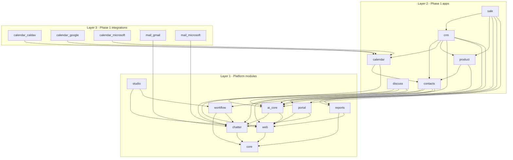
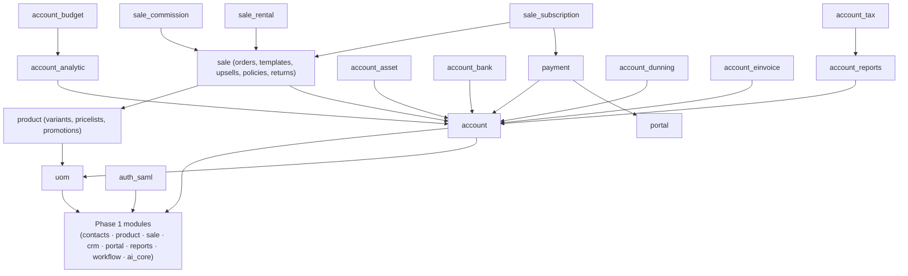
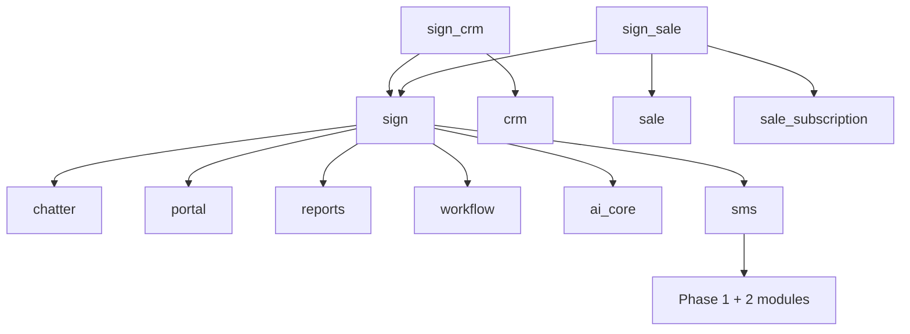
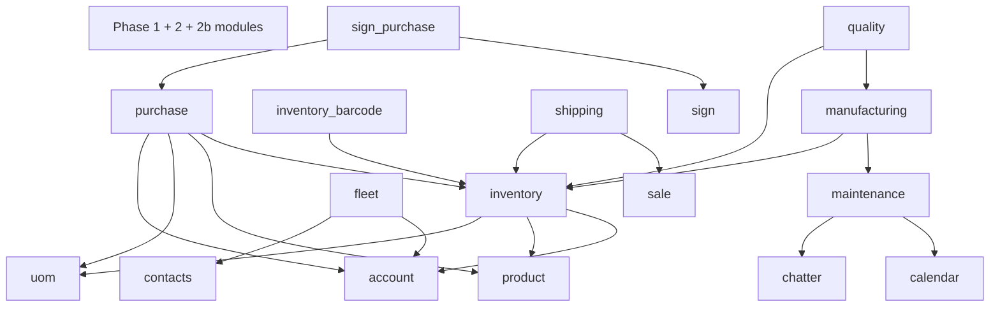
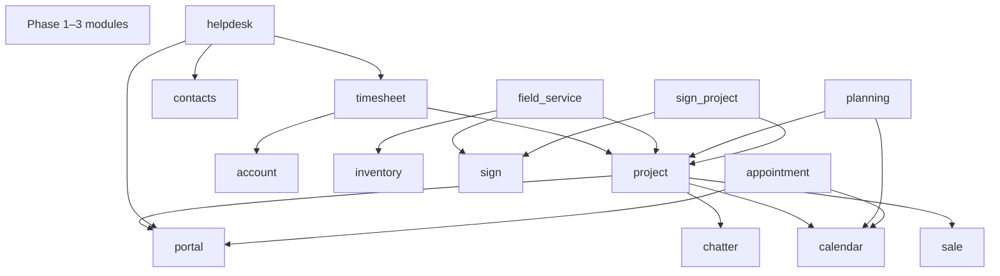
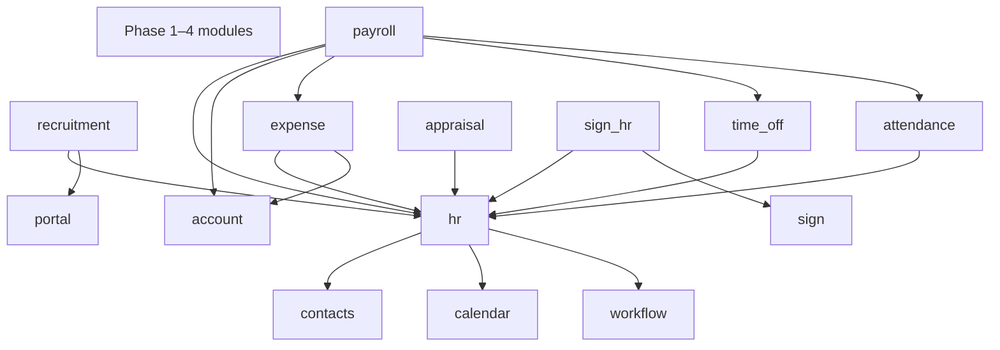
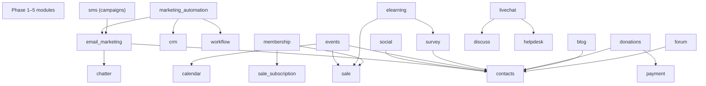
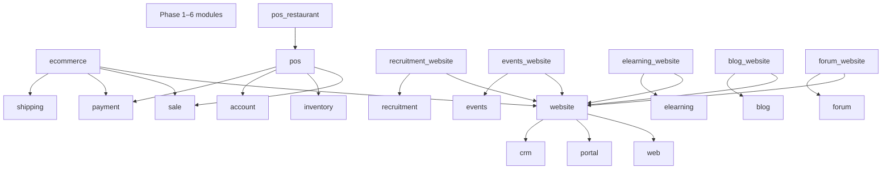

# Tessera — Module Dependency Map

**Status:** Draft for approval (pre–Phase 1)
**Companion documents:** [Architecture](ARCHITECTURE.md) · [Core ERD](ERD_CORE.md) · [AI architecture note](AI_ARCHITECTURE.md) · [Phased build plan](BUILD_PLAN.md) · [DECISIONS.md](../../DECISIONS.md)

---

## 1. How dependencies work

A module's `manifest.toml` lists the modules it needs in `depends`. The dependency closure is resolved topologically at install time (ARCHITECTURE.md §4.1); a module is loaded only after everything it depends on, and may only extend models, views, menus, security groups and AI tools that belong to itself or to a module in its closure. Uninstall refuses while any installed module still depends on the target.

**Layering rule.** Modules sit in four layers. A module may depend on its own layer or on a lower layer, **never upward**:

| Layer | Contents | May depend on |
|---|---|---|
| 0 · Kernel | the `tessera` Python package (ORM, security, API, views, jobs, realtime, CLI) — not a module | — |
| 1 · Platform modules | `core`, `chatter`, `web`, `workflow`, `reports`, `studio`, `ai_core`, `portal` | layer 1 |
| 2 · Apps | business modules (`contacts`, `crm`, `account`, `inventory`, `hr`, …) | layers 1–2 |
| 3 · Bridge & integration modules | glue between two apps (`sign_crm`) or to an external service (`calendar_google`) | layers 1–3 |

`core` is the root of every closure. `web` is required by anything that has a menu. `chatter` is required by anything that has a thread, followers or activities.

**AI rule.** Every business module (layer 2) depends on `ai_core`, because the definition of done requires each module to ship at least one AI feature in its first release (spec §3A). The feature, its prompts, tools and evaluation set live in the module's `ai/` directory and are loaded by `ai_core` at install time.

Naming: module directories are lowercase snake_case under `backend/modules/`; models are `module.model` (D-006). Names are original and descriptive; no other suite's module vocabulary is used.

---

## 2. Phase 1 — platform and CRM



`sale` in Phase 1 is quotations only (draft → sent → accepted/rejected/expired, PDF, portal acceptance); Phase 2 extends it in place (D-011).

---

## 3. Later phases

Earlier phases are collapsed into a single node per phase (`P1`, `P2`, …) to keep each diagram readable; a module that depends on an earlier phase depends on the specific modules named in the table in §4.

### 3.1 Phase 2 — Sales and Accounting



### 3.2 Phase 2b — E-Signature



`sign_purchase`, `sign_hr`, `sign_project`, `sign_documents`, `sign_knowledge` and `sign_approvals` are bridge modules that install in the phase that delivers their second parent (3, 5, 4, 8, 8, 8). `sms` (provider adapters for one-time codes and SMS signer links) is pulled forward from Phase 6 as a transport module; its marketing features land in Phase 6.

### 3.3 Phase 3 — Supply chain and manufacturing



### 3.4 Phase 4 — Operations and field services



### 3.5 Phase 5 — People (HR)



`recruitment` publishes job postings; the public job page is a bridge (`recruitment_website`, auto-installed) so `recruitment` itself does not depend upward on Phase 7.

### 3.6 Phase 6 — Marketing and engagement



Several Phase 6 modules have public-facing pages (event pages, course pages, blog, forum). These depend on `portal` for authenticated access in Phase 6 and gain full website pages through `*_website` bridges when Phase 7 lands.

### 3.7 Phase 7 — Website, eCommerce and POS



### 3.8 Phase 8 — Knowledge, documents and administration

```mermaid
flowchart TB
    P7["Phase 1–7 modules"]
    documents --> chatter_p8["chatter"]
    documents --> workflow_p8["workflow"]
    documents --> portal_p8["portal"]
    knowledge --> chatter_p8
    knowledge --> portal_p8
    approvals --> workflow_p8
    approvals --> hr_p8["hr"]
    todo --> chatter_p8
    notes --> chatter_p8
    dashboards --> web_p8["web"]
    dashboards --> reports_p8["reports"]
    spreadsheet --> dashboards
    marketplace --> web_p8
    iot --> maintenance_p8["maintenance"]
    iot --> quality_p8["quality"]
    assistant --> ai_core_p8["ai_core"]
    assistant --> web_p8
    ai_admin --> ai_core_p8
    ai_admin --> dashboards
    sign_documents --> documents
    sign_documents --> sign_p8["sign"]
    sign_knowledge --> knowledge
    sign_knowledge --> sign_p8
    sign_approvals --> approvals
    sign_approvals --> sign_p8
    integrations_slack --> discuss_p8["discuss"]
    integrations_teams --> discuss_p8
    storage_gdrive --> documents
    storage_onedrive --> documents
    integrations_zapier --> core_p8["core"]
```



---

## 4. Full module table

Layer: **P** platform, **A** app, **B** bridge/integration. "Depends on" lists direct dependencies only (`core` is implied everywhere and omitted; `ai_core` is listed because it is a definition-of-done requirement). The last column names the AI feature(s) the module must ship in its first release (spec §3A).

### Platform (Phase 1)

| Module | Phase | Layer | Depends on | Summary | First-release AI feature(s) |
|---|---|---|---|---|---|
| `core` | 1 | P | — | Company, user, group, currency, country, language, sequence, attachment, audit, jobs, notifications, API keys, webhooks, import/export | — (platform) |
| `chatter` | 1 | P | — | Message threads, notes, followers, tracked changes, attachments, scheduled activities, email bridge | — (platform) |
| `web` | 1 | P | — | Menus, actions, view registry, global search index, recents, favourites, client asset registry | — (platform) |
| `workflow` | 1 | P | `chatter` | State machines as data, transitions with guards, automated actions (on create/write/time/transition) | — (platform) |
| `reports` | 1 | P | `web` | PDF template store, per-company layouts, visual template editor, QR codes | — (platform) |
| `studio` | 1 | P | `web`, `workflow` | No-code fields, layouts, views, automations, with versioning and rollback | NL creation of fields/views/automations (Phase 8) |
| `ai_core` | 1 | P | `chatter`, `web` | Provider config, routing tables, prompt registry, tools, retrieval index, proposals, audit, feedback, evals, flags, budgets | — (it *is* the platform) |
| `portal` | 1 | P | `web`, `chatter` | External-user access: portal group, narrow record rules, document sharing, signup | — (platform) |

### Phase 1 apps and integrations

| Module | Phase | Layer | Depends on | Summary | First-release AI feature(s) |
|---|---|---|---|---|---|
| `contacts` | 1 | A | `chatter`, `web`, `portal`, `ai_core` | Companies and individuals, hierarchy, contact types, tags, addresses, merge, portal access | Duplicate detection; tag and hierarchy suggestions; enrichment with attribution |
| `discuss` | 1 | A | `chatter`, `web`, `ai_core` | Channels, direct messages, mentions, threads, file sharing, emoji | Thread/channel summaries; catch-me-up; reply drafts; translation |
| `calendar` | 1 | A | `contacts`, `ai_core` | Day/week/month views, shared calendars, meetings, room booking, sync adapter contract | Meeting briefs; suggested times; NL scheduling |
| `product` | 1 | A | `contacts`, `ai_core` | Basic product catalogue (variants, pricelists arrive in Phase 2) | Description drafts (minimal; full set Phase 7 `ecommerce`) |
| `crm` | 1 | A | `contacts`, `calendar`, `product`, `workflow`, `reports`, `ai_core` | Leads, opportunities, pipelines, teams, auto-assignment, rule-based scoring, activity dashboard, funnel reports | Predictive scoring and win probability with explanations; next-best-action; deal risk alerts; lead routing; lead extraction from email/forms; forecasting; follow-up/proposal drafts; call/meeting summaries; objection handling; NL search → filters; AI-ranked daily to-do |
| `sale` | 1 → 2 | A | `crm`, `product`, `reports`, `portal`, `ai_core` | Phase 1: quotations from opportunities, PDF, portal acceptance. Phase 2: orders, templates, optional products, policies, returns | Phase 1: quote follow-up drafts (shared with CRM). Phase 2: upsell/cross-sell; discount suggestions; quote lines from pasted text/RFP; pricing-policy flags |
| `calendar_caldav` | 1 | B | `calendar` | CalDAV two-way sync | — (adapter) |
| `calendar_google` | 1 | B | `calendar` | Google Calendar OAuth sync | — (adapter) |
| `calendar_microsoft` | 1 | B | `calendar` | Microsoft 365 calendar sync via Graph | — (adapter) |
| `mail_gmail` | 1 | B | `chatter` | Gmail API inbound/outbound adapter | — (adapter) |
| `mail_microsoft` | 1 | B | `chatter` | Microsoft 365 mail adapter via Graph | — (adapter) |

### Phase 2 — Sales and Accounting

| Module | Phase | Layer | Depends on | Summary | First-release AI feature(s) |
|---|---|---|---|---|---|
| `uom` | 2 | A | `ai_core` | Units of measure and conversions | — (shared master data; counts as part of `product`) |
| `sale_commission` | 2 | A | `sale`, `ai_core` | Commission plans, statements, payouts | Plain-language commission statement explanations |
| `sale_subscription` | 2 | A | `sale`, `payment`, `ai_core` | Recurring billing, proration, renewals, churn tracking | Churn prediction; personalised renewal drafts; usage anomaly alerts |
| `sale_rental` | 2 | A | `sale`, `ai_core` | Rental orders, availability calendars, pickup/return | Rental demand forecasting |
| `account` | 2 | A | `contacts`, `product`, `uom`, `workflow`, `reports`, `portal`, `ai_core` | Chart of accounts, journals, fiscal periods, invoices, bills, credit notes, payments, taxes, fiscal positions, multi-currency | Invoice/bill OCR with auto-coding; anomaly detection; cash-flow forecasting; NL reports; personalised dunning |
| `account_analytic` | 2 | A | `account` | Cost centres, analytic plans and distribution | Analytic allocation suggestions |
| `account_budget` | 2 | A | `account_analytic` | Budgets and budget-vs-actual | Plain-language variance explanations |
| `account_asset` | 2 | A | `account` | Fixed assets and depreciation schedules | Asset classification from invoice text; depreciation anomaly checks |
| `account_bank` | 2 | A | `account` | Statement import (CSV, OFX, CAMT.053, MT940), reconciliation rules, bank feeds | Reconciliation suggestions |
| `account_reports` | 2 | A | `account` | Financial reports engine: general ledger, trial balance, P&L, balance sheet, cash flow, aged balances, partner ledger, consolidation | Natural-language reports (parameters for review) |
| `account_tax` | 2 | A | `account_reports` | Tax return reports, closing entries | Pre-filing anomaly checks |
| `account_dunning` | 2 | A | `account` | Dunning levels, payment reminders, fees | Personalised dunning messages |
| `auth_saml` | 2 | B | `core` | SAML 2.0 single sign-on (D-013) | — (platform) |
| `account_einvoice` | 2 | A | `account` | Peppol/UBL e-invoicing through country adapters | Mapping error explanations |
| `payment` | 2 | A | `account`, `portal` | Payment providers (Stripe, PayPal, …), tokens, portal payments | Failed-payment reason summaries |

### Phase 2b — E-Signature

| Module | Phase | Layer | Depends on | Summary | First-release AI feature(s) |
|---|---|---|---|---|---|
| `sign` | 2b | A | `chatter`, `portal`, `reports`, `workflow`, `sms`, `ai_core` | Templates, roles, fields, envelopes, routing, signer experience, authentication levels, PAdES sealing, RFC 3161 timestamps, hash-chained audit, Certificate of Completion, verification page | Merge-field pre-fill from existing contracts; version change summaries; advisory risky-clause flags |
| `sms` | 2b | A | `contacts`, `ai_core` | SMS provider adapters, opt-out registry (campaigns in Phase 6) | Message drafts; opt-out compliance checks |
| `sign_crm` | 2b | B | `sign`, `crm`, `sale` | Send quote for signature from an opportunity; signed → won + order confirmed | — |
| `sign_sale` | 2b | B | `sign`, `sale`, `sale_subscription` | Order acceptance, recurring contract renewal | — |
| `sign_purchase` | 3 | B | `sign`, `purchase` | Purchase agreements, vendor contracts | — |
| `sign_hr` | 5 | B | `sign`, `hr` | Offer letters, contracts, policy acknowledgments, onboarding packs attached to employee (role-restricted) | — |
| `sign_project` | 4 | B | `sign`, `project` | Statements of work; signature-triggered milestones | — |
| `sign_documents` | 8 | B | `sign`, `documents` | Store sealed PDF and certificate; send for signature from Documents | — |
| `sign_knowledge` | 8 | B | `sign`, `knowledge` | Policy acknowledgments with due dates and tracking | — |
| `sign_approvals` | 8 | B | `sign`, `approvals` | Signature step inside an approval flow | — |

### Phase 3 — Supply chain and manufacturing

| Module | Phase | Layer | Depends on | Summary | First-release AI feature(s) |
|---|---|---|---|---|---|
| `purchase` | 3 | A | `account`, `uom`, `product`, `inventory`, `ai_core` | Vendors, vendor pricelists, RFQs, POs, agreements, approval thresholds, three-way matching, landed costs, vendor performance | RFQ drafts from demand; supplier recommendations; late-delivery prediction; bill-to-PO mismatch explanations |
| `inventory` | 3 | A | `uom`, `product`, `account`, `ai_core` | Warehouses, locations, routes, putaway/removal (FIFO/LIFO/FEFO), lots/serials, expiry, packages, valuation, moves, counts, scrap, reorder rules, dropship, consignment, returns, backorders | Demand forecasting; reorder suggestions; vision-based receiving checks; FEFO expiry-risk alerts |
| `inventory_barcode` | 3 | A | `inventory` | Mobile barcode flows: receive, pick, pack, ship, count | Scan anomaly hints (shares `inventory` evals) |
| `shipping` | 3 | A | `inventory`, `sale` | Carrier integrations, labels, tracking | Carrier/service recommendation |
| `manufacturing` | 3 | A | `inventory`, `maintenance`, `ai_core` | Multi-level BoMs, routings, work centres, MOs, work orders, shop-floor screen, subcontracting, MRP, costing | Production scheduling optimisation; yield prediction; BoM cost-change explanations |
| `quality` | 3 | A | `inventory`, `manufacturing`, `ai_core` | Control points, checks, alerts, corrective actions | Defect detection from images; root-cause suggestions; control-point drafts from specs |
| `maintenance` | 3 | A | `chatter`, `calendar`, `ai_core` | Equipment, preventive schedules, corrective requests, teams, calendar | Predictive maintenance from logs/sensors; automatic request creation from anomalies |
| `fleet` | 3 | A | `contacts`, `account`, `ai_core` | Vehicles, contracts, service logs, fuel, odometer, costs | Fuel/cost anomaly detection; service prediction; allocation suggestions; receipt extraction |

### Phase 4 — Operations and field services

| Module | Phase | Layer | Depends on | Summary | First-release AI feature(s) |
|---|---|---|---|---|---|
| `project` | 4 | A | `chatter`, `calendar`, `sale`, `portal`, `ai_core` | Projects, tasks, dependencies, subtasks, stages, kanban, Gantt, milestones, recurring tasks, profitability, customer sharing | Task breakdown from brief; effort estimates; schedule risk alerts; status report drafts |
| `timesheet` | 4 | A | `project`, `account`, `ai_core` | Timers, approvals, billable time, invoicing of time | Narrative drafts; missing/overlap detection; billable classification |
| `helpdesk` | 4 | A | `contacts`, `portal`, `timesheet`, `ai_core` | Channels, teams, SLA policies, ticket types, canned responses, knowledge link, satisfaction surveys | Triage/prioritisation; KB-suggested replies; auto-resolution with escalation; agent assist; sentiment priority |
| `field_service` | 4 | A | `project`, `inventory`, `sign`, `ai_core` | Dispatch board, schedules, routes, work orders, parts, signature on completion, geolocation check-in | Route optimisation; skill matching; duration estimates; parts prediction |
| `planning` | 4 | A | `calendar`, `project`, `ai_core` | Shift and resource planning, templates, open shifts, availability | Shift generation from forecasts; overtime/fatigue alerts |
| `appointment` | 4 | A | `calendar`, `portal`, `ai_core` | Booking pages, availability rules, reminders, resource allocation | Smart slot suggestions; no-show prediction; personalised reminders |

### Phase 5 — People (HR)

| Module | Phase | Layer | Depends on | Summary | First-release AI feature(s) |
|---|---|---|---|---|---|
| `hr` | 5 | A | `contacts`, `calendar`, `workflow`, `ai_core` | Employees, org chart, departments, positions, skills, contracts, documents, role-restricted private data | Skills-gap analysis; onboarding checklists; org-chart Q&A (permission-bound) |
| `recruitment` | 5 | A | `hr`, `portal`, `ai_core` | Job postings (minimal public page via `portal`; full pages via `recruitment_website`), applicant pipeline, interviews, scorecards, offers, candidate-to-employee | Resume parsing; bias-tested candidate matching; interview question drafts; job descriptions; message drafts |
| `time_off` | 5 | A | `hr`, `ai_core` | Leave types, accruals, allocations, approvals, public holidays, balances | Manager summaries; policy Q&A; coverage-conflict detection |
| `attendance` | 5 | A | `hr`, `ai_core` | Kiosk/web/mobile/geofence check-in, overtime rules | Missing check-out and irregular pattern detection; overtime summaries |
| `expense` | 5 | A | `hr`, `account`, `ai_core` | Claims, receipts, policies, mileage, multi-currency, approvals, reimbursement | Receipt OCR and categorisation; policy violation flags; duplicate claim detection |
| `appraisal` | 5 | A | `hr`, `ai_core` | Goals, 360° feedback, review cycles | Summary drafts and goal suggestions (manager-reviewed, bias-tested) |
| `payroll` | 5 | A | `hr`, `account`, `expense`, `time_off`, `attendance`, `ai_core` | Salary structures, rules engine, payslip batches, country tax/social packs, payslip PDFs, bank files | Pre-run anomaly detection; payslip Q&A; tax-change explanations |

### Phase 6 — Marketing and engagement

| Module | Phase | Layer | Depends on | Summary | First-release AI feature(s) |
|---|---|---|---|---|---|
| `email_marketing` | 6 | A | `contacts`, `chatter`, `ai_core` | Drag-and-drop builder, lists, segmentation, A/B tests, bounce/unsubscribe, consent, analytics | Copy and subject variants; send-time optimisation; personalised blocks; NL segmentation |
| `marketing_automation` | 6 | A | `email_marketing`, `crm`, `workflow`, `ai_core` | Multi-step campaigns (wait/branch/send/update), CRM triggers, UTM tracking | Journey suggestions; branching recommendations |
| `social` | 6 | A | `contacts`, `ai_core` | Post scheduling across networks, analytics | Per-network drafts; best-time suggestions; reply drafts; brand-guarded image generation |
| `events` | 6 | A | `contacts`, `sale`, `calendar`, `ai_core` | Ticket types, registration, QR check-in, reminders, sponsors | Attendee matching; session recommendations; sponsor ROI summaries; follow-up drafts |
| `survey` | 6 | A | `contacts`, `ai_core` | Builder, conditional logic, scoring, invitations, results, certifications | Theme extraction and sentiment; question-design suggestions |
| `elearning` | 6 | A | `survey`, `sale`, `ai_core` | Courses, lessons, quizzes, certificates, progress, paid courses | Outlines/quizzes from documents; grounded tutor; adaptive paths |
| `membership` | 6 | A | `sale`, `sale_subscription`, `ai_core` | Membership products, auto-renewal, member portal | Member churn prediction |
| `donations` | 6 | A | `payment`, `contacts`, `ai_core` | Recurring donation forms, receipts | Donor propensity scoring; thank-you drafts |
| `livechat` | 6 | A | `discuss`, `helpdesk`, `ai_core` | Visitor tracking, chatbot rules, operator routing | Grounded website assistant with human handoff and transcript |
| `blog` | 6 | A | `contacts`, `ai_core` | Posts, authors, moderation | Outlines from topic gaps; moderation flags (human review) |
| `forum` | 6 | A | `contacts`, `ai_core` | Questions, answers, moderation | Thread summaries; moderation flags (human review) |

### Phase 7 — Website, eCommerce and POS

| Module | Phase | Layer | Depends on | Summary | First-release AI feature(s) |
|---|---|---|---|---|---|
| `website` | 7 | A | `web`, `portal`, `crm`, `ai_core` | Drag-and-drop pages, themes, SEO, multi-website, multilingual, cookie consent, forms → CRM, custom domains | Copy/layout suggestions; SEO metadata; alt-text drafts; translation for review |
| `ecommerce` | 7 | A | `website`, `sale`, `payment`, `shipping`, `ai_core` | Catalogue, faceted search, reviews, wishlists, carts, checkout, coupons, gateways, abandoned-cart, B2B pricing | Product descriptions; SEO; grounded shopping assistant; semantic search; recommendations; review summaries; guard-railed pricing |
| `pos` | 7 | A | `sale`, `inventory`, `account`, `payment`, `ai_core` | Terminal, payment methods, cash sessions, offline mode, receipts, loyalty, gift cards, kiosks | Product recognition from images; upsell prompts; cash variance explanations |
| `pos_restaurant` | 7 | A | `pos` | Floor plans, kitchen display, self-order | Kitchen demand prediction |
| `recruitment_website` | 7 | B | `website`, `recruitment` | Public job pages and application forms | — |
| `events_website` | 7 | B | `website`, `events` | Event pages and registration | — |
| `elearning_website` | 7 | B | `website`, `elearning` | Public course pages | — |
| `blog_website` | 7 | B | `website`, `blog` | Public blog | — |
| `forum_website` | 7 | B | `website`, `forum` | Public forum | — |

### Phase 8 — Knowledge, documents and administration

| Module | Phase | Layer | Depends on | Summary | First-release AI feature(s) |
|---|---|---|---|---|---|
| `documents` | 8 | A | `chatter`, `workflow`, `portal`, `ai_core` | Folders, tags, versioning, workspaces, OCR, auto-filing | Classification; field extraction; semantic search; Q&A with citations |
| `knowledge` | 8 | A | `chatter`, `portal`, `ai_core` | Wiki articles, templates, collaborative editing, internal/portal access | Drafts from resolved tickets; stale/duplicate detection |
| `approvals` | 8 | A | `workflow`, `hr`, `ai_core` | Request types, multi-level approvals, amount rules | Approver recommendations; request summaries; policy flags |
| `todo` | 8 | A | `chatter`, `ai_core` | Personal to-dos | Task extraction from notes and chatter |
| `notes` | 8 | A | `chatter`, `ai_core` | Notes and meeting notes | Meeting summaries |
| `dashboards` | 8 | A | `web`, `reports`, `ai_core` | Custom dashboards, saved reports, exports, embedded charts, scheduled report emails | NL chart creation; narrative insights; KPI anomaly alerts |
| `spreadsheet` | 8 | A | `dashboards`, `ai_core` | Collaborative spreadsheet on live data, formulas, pivots | Formula help; NL-to-formula; data-cleaning suggestions |
| `marketplace` | 8 | A | `web`, `ai_core` | Module store, versioning, install from catalogue | Compatibility/risk checks; advisory recommendations by industry |
| `iot` | 8 | A | `maintenance`, `quality`, `ai_core` | Device registry, sensor ingestion | Sensor anomaly detection; predictive alerts |
| `assistant` | 8 | A | `ai_core`, `web` | Cross-module copilot in global search, permission-bound | Global assistant |
| `ai_admin` | 8 | A | `ai_core`, `dashboards` | AI usage, cost, adoption and quality dashboards | Admin dashboards |
| `integrations_slack` | 8 | B | `discuss` | Slack channel bridge and notifications | — |
| `integrations_teams` | 8 | B | `discuss` | Microsoft Teams bridge | — |
| `storage_gdrive` | 8 | B | `documents` | Google Drive sync | — |
| `storage_onedrive` | 8 | B | `documents` | OneDrive sync | — |
| `integrations_zapier` | 8 | B | `core` | Zapier/Make-friendly webhook triggers and actions | — |

---

## 5. Bridge module convention

When two apps need to know about each other, neither depends on the other. The integration lives in a **bridge module** that depends on both parents, is `auto_install = true`, and is installed automatically as soon as both parents are present (and uninstalled when either is removed). A bridge contains only glue: extension fragments (`_extend`), view inheritance operations, automated actions, a few security rules, and bridge-specific AI tools. It never introduces a business concept of its own.

Examples:

| Bridge | Parents | What it adds |
|---|---|---|
| `sign_crm` | `sign`, `crm`, `sale` | "Send for signature" on the opportunity; on completion mark won and confirm the order |
| `sign_hr` | `sign`, `hr` | Offer letters and contracts from employee records; signed PDFs attach to the employee, restricted by role |
| `recruitment_website` | `recruitment`, `website` | Public job pages and application forms that create applicants |
| `livechat` ↔ `helpdesk` | (`livechat` depends directly) | Convert a chat into a ticket — kept as a direct dependency because livechat without helpdesk is not shipped |
| `events_website` | `events`, `website` | Event landing pages and online registration |
| `storage_gdrive` | `documents`, external service | Adapter-style bridge: depends on one app and wraps an external API |
| `timesheet` ↔ `account` | (`timesheet` depends directly) | Invoicing billable time — a direct dependency because `timesheet` requires invoicing |

Rule of thumb: if a module is useful without the other parent, make a bridge; if it is not, make a direct dependency.

---

## 6. Extension points offered by platform modules

- **`core`** — mixins `core.multi_company` (adds `company_id` + rule), `core.sequence_mixin` (auto-numbering), `core.soft_delete`; registration hooks for currency-rate providers, storage backends, authentication providers (OIDC/SAML), import/export formats and webhook event types.
- **`chatter`** — `chatter.thread` (messages, followers, tracking), `chatter.activity_mixin` (scheduled activities), `chatter.alias_mixin` (inbound email alias → `message_new`), notification subtypes, message post-processing hooks.
- **`web`** — menus, window/server/client/report/URL actions, view registration and inheritance operations, global-search opt-in (`_global_search`), client extension registry (custom widgets, client actions), favourite and recent-item providers.
- **`workflow`** — `workflow.definition` on any state field, transition guards and side effects declared as data or methods, automated-action triggers and action types (modules can register new action types, e.g. "create envelope").
- **`studio`** — every model and view is customisable unless flagged `_studio = False`; modules can expose extra widget options and automation templates to Studio.
- **`reports`** — report templates bound to a model, layout slots (header/footer/footer-notes), QR payload providers, line-model table partials.
- **`ai_core`** — `ai/features.yaml` (feature flag, risk class, thresholds), `ai/prompts/*.yaml` (versioned prompts), `ai/tools.py` (permission-scoped tools), `ai/evals/*.jsonl` (golden sets), retrieval opt-in (`_ai_index = [...]` fields to embed), proposal handlers (how an accepted proposal is applied), explainability providers for scores.
- **`portal`** — `portal.shared_mixin` (access tokens, portal URLs), portal menu entries, record rules template for `partner_id = $user.partner_id`, portal page controllers.

---

## 7. Install order for a fresh Phase 1 database

Topologically sorted (ties broken alphabetically). `tessera module install crm sale discuss calendar_caldav` on an empty database resolves to:

```
 1. core
 2. chatter
 3. web
 4. portal
 5. reports
 6. workflow
 7. studio
 8. ai_core
 9. contacts
10. discuss
11. calendar
12. product
13. crm
14. sale
15. calendar_caldav        (and calendar_google / calendar_microsoft / mail_gmail / mail_microsoft if requested)
```

`core`, `web`, `chatter` and `ai_core` are marked `auto_install = true` and are present in every database. Uninstall proceeds in exactly the reverse order, refusing at any module that still has installed dependents.
